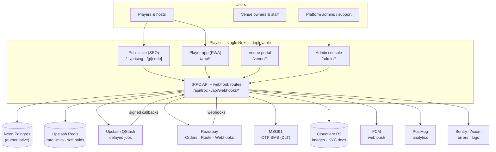
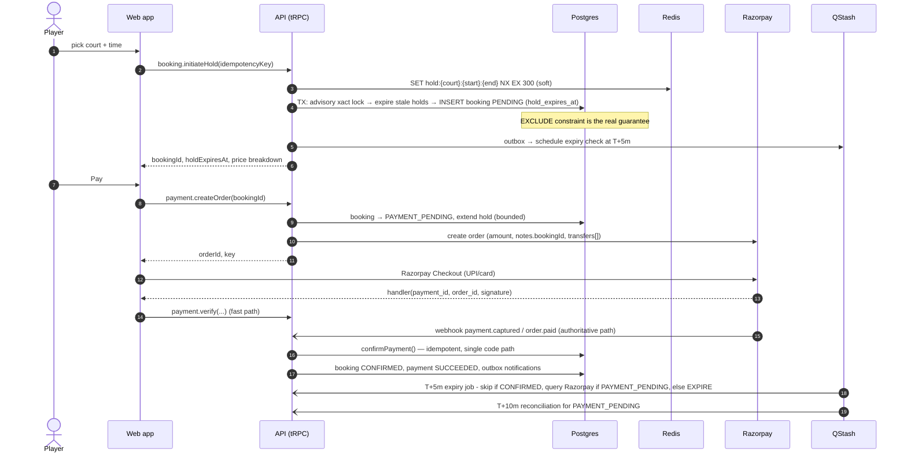

# 02 · System Architecture

| | |
|---|---|
| **Status** | v2.0 — reviewed and corrected against v1 (see [11-audit-report](./11-audit-report.md)) |
| **Audience** | Engineering lead, backend/full-stack engineers, DevOps |
| **Read first** | [00-start-here](./00-start-here.md) |
| **Related** | [03-data-model](./03-data-model.md) · [04-api-specification](./04-api-specification.md) · [05-business-logic](./05-business-logic.md) · [10-decision-log](./10-decision-log.md) |

---

## 1. Purpose and scope

Playlo is a sports-networking and court-booking platform. Launch scope is **badminton in Sirsa, Haryana**. This document defines the system boundaries, deployment topology, runtime behaviour, cross-cutting conventions and non-functional targets. It does **not** define business rules (see 05) or schema (see 03).

**Design constraint that shapes everything:** the system is built and operated by one to three engineers. Every component must justify its operational cost. Where v1 specified more moving parts than the problem needs, v2 simplifies and records the change in the [decision log](./10-decision-log.md).

## 2. Architectural principles

| # | Principle | Consequence |
|---|---|---|
| P1 | **Modular monolith, not microservices.** One deployable, one database, strict internal module boundaries. | Shared types, one transaction scope, one deploy to roll back. |
| P2 | **Postgres is the only source of truth.** Redis and queues hold ephemeral or derived state only. | Any Redis loss degrades UX, never correctness. |
| P3 | **Invariants live in the database.** Anything that must *never* happen (overlapping bookings, over-capacity games, duplicate payments) is enforced by a constraint, not only by application code. | Application bugs cannot corrupt money or inventory. |
| P4 | **Payment state is authoritative only from the provider.** A redirect or client callback never confirms a booking by itself. | One idempotent `confirmPayment()` path reached by webhook, client verify and reconciliation. |
| P5 | **Everything that touches money is idempotent and auditable.** | Every state change writes an audit row; every external call carries an idempotency key. |
| P6 | **One role-based platform, not four products.** Players, hosts, venue staff and admins share one identity and one API. | Permissions are data (see 07), not separate codebases. |
| P7 | **India-first defaults.** Phone-OTP login, UPI, paise, IST display, WhatsApp as primary sharing channel, low-bandwidth Android as the reference device. | Drives CSP, PWA, i18n and payments choices. |
| P8 | **Do not ship planned features as live.** Phase gating is enforced server-side (see 08 §Feature flags). | Hidden UI is never the only barrier. |

## 3. System context



## 4. Deployment topology

| Component | Provider / product | Region | Purpose | If it fails |
|---|---|---|---|---|
| Web + API runtime | Vercel (Pro) | Functions pinned to the **same region as the DB** (see ADR-003); static assets on global CDN | Next.js RSC, tRPC, webhooks | Roll back to previous deployment (< 1 min) |
| Primary database | Neon Postgres 16 + PostGIS + `btree_gist` | **`aws-ap-southeast-1` (Singapore)** — Neon has no Mumbai region (verified Oct 2026; re-check before provisioning) | Authoritative state | Neon PITR to branch (see §12) |
| Ephemeral store | Upstash Redis (REST) | Nearest to DB region | Rate limiting, soft slot holds, OTP cooldown counters | Degrade: rate limits fail *open for reads, closed for OTP/payments*; holds fall back to DB |
| Job scheduler | Upstash QStash | Global | Delayed jobs (hold expiry, reminders, reconciliation) | Jobs are re-derivable from DB by a nightly sweep |
| Payments | Razorpay (Orders, Checkout, Route) | n/a | Collect + split payments | Bookings stay `PAYMENT_PENDING`; reconciliation job resolves |
| SMS/OTP | MSG91 (DLT-registered templates) | n/a | Phone OTP, transactional SMS | OTP unavailable → Google sign-in fallback (if enabled) |
| Object storage | Cloudflare R2 (private buckets for KYC) + Next/Image or Cloudflare Images for resizing | n/a | Avatars, venue photos, KYC docs | Uploads fail; read paths cached |
| Push | Firebase Cloud Messaging | n/a | Web push | Fall back to in-app + SMS for critical events |
| Analytics / flags | PostHog (events), server-side flag evaluation | EU or US cloud (decision in [12](./12-open-items.md)) | Product analytics | Fail closed on flags (feature off) |
| Errors / logs | Sentry, Axiom | n/a | Observability | Non-critical |

### 4.1 Database connectivity rules (Neon)

- **Pooled connection** (hostname contains `-pooler`, standard port 5432) for the application → `DATABASE_URL`. Add `?pgbouncer=true&connection_limit=1` for Prisma on serverless.
- **Direct connection** for migrations only → `DIRECT_DATABASE_URL`.
- v1 stated "PgBouncer on port 6543". That is a Supabase convention, not Neon; do not copy it.
- Transaction-mode pooling forbids session-level features. Use **`pg_advisory_xact_lock`** (transaction-scoped) only; never `pg_advisory_lock`, `LISTEN/NOTIFY`, or `SET` outside a transaction.
- Preview deployments get a **Neon branch per PR**; migrations run against the branch, never against production from CI.

### 4.2 Latency budget (replaces v1's "sub-15 ms to Mumbai edge")

| Hop | Expected |
|---|---|
| Device (Sirsa, 4G) → Vercel edge | 30–80 ms |
| Edge → function in Singapore | 60–90 ms |
| Function → Neon (same region) | 1–3 ms per query |
| Booking reservation transaction (≈ 6 queries) | 20–60 ms |

These are planning estimates, not measurements. **Action:** measure p95 on a staging deployment in Sprint 0; if user-perceived p95 for `venue.getAvailability` exceeds the target in §10, evaluate moving the database to a Mumbai-hosted provider (ADR-003 lists the options).

## 5. Repository layout

A Turborepo + pnpm monorepo, but **one deployable app** for the MVP (ADR-002). v1 specified four separate Next.js apps; that multiplies builds, deployments, cookies, service workers and webhook endpoints without a corresponding benefit at this scale. Route groups give the same separation of concerns.

```text
playlo/
├── apps/
│   └── web/                          # the single deployable
│       ├── app/
│       │   ├── (marketing)/          # /, /how-it-works, /pricing, /cities/*, /legal/*  (RSC, ISR)
│       │   ├── g/[code]/             # public, noindex share page with OG image (see 05 §8)
│       │   ├── app/                  # player PWA — /app/*
│       │   ├── venue/                # venue portal — /venue/*
│       │   ├── admin/                # admin console — /admin/*
│       │   └── api/
│       │       ├── trpc/[trpc]/      # single tRPC endpoint
│       │       ├── webhooks/razorpay/
│       │       └── jobs/             # QStash callbacks (signature-verified)
│       ├── middleware.ts             # auth presence, security headers, noindex for private areas
│       └── public/
├── packages/
│   ├── db/            # schema.prisma, migrations (incl. raw SQL), client, seed
│   ├── api/           # routers, procedures, services (booking, game, payments, jobs)
│   ├── auth/          # auth config, permission matrix, session helpers
│   ├── validators/    # Zod schemas — single source of input truth
│   ├── domain/        # pure functions: fees, refunds, reliability, availability (no I/O)
│   ├── ui/            # shadcn/ui + Radix + Tailwind v4 components
│   ├── config/        # env schemas, flags registry, tailwind theme, tsconfig, eslint, i18n
│   └── logger/        # structured logging wrapper
├── .github/workflows/ # ci.yml, migrate.yml (see 08)
├── turbo.json · pnpm-workspace.yaml · package.json
└── docs/
```

**Dependency rules** (enforce with `eslint-plugin-boundaries` or `dependency-cruiser`):

```text
apps/web  →  api, auth, ui, validators, config, domain
api       →  db, auth, validators, domain, config, logger
domain    →  (nothing; pure TypeScript, no I/O)      ← makes money logic trivially testable
db        →  (nothing internal)
ui        →  validators (types only), config
```

`packages/domain` is new in v2. Fee calculation, refund calculation, availability and reliability are pure functions that take data and return data. They are where the bugs would cost money, so they must be testable without a database.

**When to split into multiple apps:** only when a concrete trigger occurs — separate release cadence for the venue portal, a different team owning admin, or measurable bundle/security isolation needs. The `packages/*` boundary makes the split mechanical.

## 6. Runtime views

### 6.1 Request lifecycle

1. `middleware.ts` runs at the edge: attaches a request ID, sets security headers and a per-request CSP nonce, adds `X-Robots-Tag: noindex` to `/app`, `/venue`, `/admin`, `/api`, and redirects unauthenticated users away from private prefixes (presence check only — **never** an authorisation decision).
2. React Server Components fetch via server-side tRPC callers (no HTTP hop). Client components use the tRPC React Query client against `/api/trpc`.
3. Every procedure builds `ctx` (session, db, redis, requestId, client IP), then runs its middleware chain (see 04 §3): rate limit → authenticate → authorise (permission **and** resource ownership) → validate → handler.
4. Handlers call **services** in `packages/api/src/services`, which own transactions and call `packages/domain` for pure logic.
5. Side effects (notifications, QStash jobs) are written to an **outbox** inside the same transaction and dispatched after commit (§8).

### 6.2 Booking and payment sequence



The three paths into `confirmPayment()` (client verify, webhook, reconciliation) must produce identical results when run in any order or more than once. See 05 §2.4 for the algorithm and the late-payment rules.

## 7. Cross-cutting conventions

| Concern | Convention |
|---|---|
| **Time** | Store every instant as `timestamptz` (Prisma `@db.Timestamptz(3)`), always UTC. Convert to `Asia/Kolkata` only at the UI boundary using `date-fns-tz` (or Temporal when stable). Intervals are **half-open `[start, end)`**. Never build instants from `new Date("YYYY-MM-DD")` without an explicit zone. |
| **Money** | Integer **paise** (`Int`). No floats anywhere in money paths. Rounding happens in exactly one place (`packages/domain/fees.ts`), using round-half-up on each line item, and totals are sums of rounded line items. Aggregates for analytics use `BigInt`. |
| **IDs** | Internal: `cuid2`/`cuid`. Public share codes: 8-char Crockford base32, unique, non-sequential. Human references (`BK-2026-000123`) come from a Postgres sequence, never from `Date.now()`. |
| **Errors** | Domain errors are typed (`DomainError` with stable `code`), mapped to tRPC codes in one place (04 §6). Never leak SQL or provider messages to clients. |
| **Logging** | JSON logs with `requestId`, `userId` (hashed if needed), `route`, `durationMs`. **No** phone numbers, OTPs, full emails, tokens, card/UPI data, or KYC document contents in logs. |
| **Configuration** | Zod-validated at boot; the process refuses to start on invalid config. Secrets only in Vercel env / secret manager; never committed. Server and client schemas are separate (below). |
| **Idempotency** | Mutations that create money-bearing records accept an `idempotencyKey` (UUID) stored with a unique index. Webhooks dedupe on provider event ID. |
| **Pagination** | Cursor-based, max page 50, stable ordering (`(sortKey, id)`). |
| **Localisation** | All user-visible strings via `next-intl` message keys; currency via `Intl.NumberFormat('en-IN')`; dates in IST. |

### 7.1 Environment schema (server)

```ts
// packages/config/src/env.server.ts
import { z } from 'zod';

export const serverEnv = z.object({
  NODE_ENV: z.enum(['development', 'test', 'production']),
  APP_ENV: z.enum(['local', 'preview', 'staging', 'production']),

  DATABASE_URL: z.string().url(),          // pooled
  DIRECT_DATABASE_URL: z.string().url(),   // migrations only

  UPSTASH_REDIS_REST_URL: z.string().url(),
  UPSTASH_REDIS_REST_TOKEN: z.string().min(1),
  QSTASH_TOKEN: z.string().min(1),
  QSTASH_CURRENT_SIGNING_KEY: z.string().min(1),
  QSTASH_NEXT_SIGNING_KEY: z.string().min(1),

  AUTH_SECRET: z.string().min(32),
  GOOGLE_CLIENT_ID: z.string().optional(),
  GOOGLE_CLIENT_SECRET: z.string().optional(),

  MSG91_AUTH_KEY: z.string().min(1),
  MSG91_OTP_TEMPLATE_ID: z.string().min(1),   // must be DLT-approved
  MSG91_SENDER_ID: z.string().min(1),

  RAZORPAY_KEY_ID: z.string().min(1),
  RAZORPAY_KEY_SECRET: z.string().min(1),
  RAZORPAY_WEBHOOK_SECRET: z.string().min(1),

  R2_ACCOUNT_ID: z.string().min(1),
  R2_ACCESS_KEY_ID: z.string().min(1),
  R2_SECRET_ACCESS_KEY: z.string().min(1),
  R2_PUBLIC_BUCKET: z.string().min(1),
  R2_PRIVATE_BUCKET: z.string().min(1),       // KYC docs; signed URLs only

  FCM_PROJECT_ID: z.string().optional(),
  FCM_SERVICE_ACCOUNT_JSON: z.string().optional(),

  POSTHOG_SERVER_KEY: z.string().optional(),
  SENTRY_DSN: z.string().url().optional(),
  AXIOM_TOKEN: z.string().optional(),
}).superRefine((env, ctx) => {
  // Test keys must never reach production and vice-versa.
  if (env.APP_ENV === 'production' && env.RAZORPAY_KEY_ID.startsWith('rzp_test_')) {
    ctx.addIssue({ code: 'custom', message: 'Test Razorpay key in production', path: ['RAZORPAY_KEY_ID'] });
  }
  if (env.APP_ENV !== 'production' && env.RAZORPAY_KEY_ID.startsWith('rzp_live_')) {
    ctx.addIssue({ code: 'custom', message: 'Live Razorpay key outside production', path: ['RAZORPAY_KEY_ID'] });
  }
});
```

v1 omitted the private R2 bucket, FCM, the DLT sender ID, and the environment guard against live keys in non-production. The client schema contains only `NEXT_PUBLIC_*` values (app URL, Razorpay key ID, PostHog public key/host, default city/sport).

## 8. Asynchronous work: transactional outbox + QStash

Calling QStash or sending an SMS *inside* a database transaction creates two failure modes: the job fires but the transaction rolls back, or the transaction commits and the call fails. v2 uses a **transactional outbox**:

1. Inside the business transaction, insert an `OutboxJob` row (`type`, `payload`, `dedupeKey`, `runAt`).
2. After commit, a small dispatcher publishes pending rows to QStash (immediately or with `delay`/`notBefore`) and marks them `DISPATCHED`.
3. A sweeper (QStash schedule every 5 minutes) re-dispatches rows stuck in `PENDING` beyond 2 minutes.
4. Job endpoints under `/api/jobs/*` verify the QStash signature (`Receiver.verify` with current and next signing keys), are **idempotent**, and return 2xx only when the work is durably done.

| Job | Trigger | Action |
|---|---|---|
| `booking.expire` | `holdExpiresAt` | Cancel stale `PENDING`; if `PAYMENT_PENDING`, query Razorpay first |
| `payment.reconcile` | T+10 min after order creation, then hourly up to 24 h | Fetch order/payment from Razorpay; call `confirmPayment()` or fail the payment |
| `game.reminder` | Start − 2 h (fire immediately if already inside the window — v1 silently skipped this case) | Notify confirmed participants |
| `notification.deliver` | Outbox | SMS/push/WhatsApp with exponential backoff |
| `settlement.sync` | Daily | Pull Route transfer statuses; flag mismatches |
| `ops.sweep` | Every 5 min | Re-dispatch stuck outbox rows; alert on anomalies |

## 9. Authority of each data store

| Data | Postgres | Redis | Notes |
|---|---|---|---|
| Bookings, payments, refunds, transfers | **Authoritative** | – | Constraints enforce overlap and uniqueness |
| Slot "soft hold" | Row (`PENDING` + `holdExpiresAt`) | Optional fast-path key | Redis only makes the "someone else is checking out" UX instant; correctness never depends on it |
| Rate-limit counters, OTP cooldowns | – | **Authoritative** | Loss resets limits; acceptable |
| Sessions | JWT or DB (per ADR-004) | – | |
| Feature flags | Edge Config / PostHog | – | Evaluated server-side |

## 10. Non-functional targets

These are **targets to validate**, not guarantees. Each has an owner test in [08](./08-engineering-operations.md).

| Area | Target | Measured how |
|---|---|---|
| Availability (monthly) | 99.5 % for player booking path | Uptime monitor on `/api/health` + synthetic booking |
| `venue.getAvailability` | p95 server time < 150 ms; end-to-end p95 < 600 ms on 4G | Axiom + synthetic probe from India |
| Booking reservation | p95 < 400 ms server time | Axiom |
| Webhook-to-confirmation | p95 < 10 s from provider event | Log correlation |
| Double bookings | **0** (enforced by constraint) | DB constraint + nightly integrity query |
| Unreconciled payments | **0** older than 24 h | Reconciliation report |
| Core Web Vitals (public pages) | LCP < 2.5 s, CLS < 0.1, INP < 200 ms at p75 on mid-range Android | CrUX / Lighthouse CI |
| Backup | RPO ≤ 1 min (PITR), RTO ≤ 15 min | Quarterly restore drill |

v1 promised "sub-50 ms availability checks" and "100/100 Lighthouse"; both are marketing numbers rather than testable service levels and were replaced above.

## 11. Scaling triggers

| Bottleneck | MVP approach | Trigger to change | Next step |
|---|---|---|---|
| Availability reads | Rules-based computation + one range query per court-day | > 2 000 active courts or p95 > 300 ms | Cache computed day-grids in Redis with write-through invalidation |
| Discovery / geo | `ST_DWithin` on venues (tens of rows; sequential scan is fine) | > 1 000 venues | Functional GiST index on the geography expression; later Meilisearch |
| Game feed | Indexed query on `(sportId, status, startTime)` | > 50 000 open games | Search engine with geo facets |
| Slot contention | Constraint + advisory lock | Sustained lock waits > 100 ms | Per-court queueing; shorter transactions |
| Connections | Neon pooler | Pooler saturation alerts | Read replica for analytics; split admin queries |
| SMS cost | Single aggregator | > 15 000 SMS/month | Add WhatsApp OTP/notifications, negotiate tiers |

## 12. Resilience and disaster recovery

| Failure | Detection | Automated response | Manual step | RPO / RTO |
|---|---|---|---|---|
| Bad production migration | CI migration job fails; error spike | Migrations are additive-first (expand → migrate → contract) | Neon PITR to a branch at T−60 s, verify, promote | ≤ 1 min / ≤ 15 min |
| Bad deploy | Sentry error rate, synthetic probe | Vercel instant rollback | Fix forward | 0 / < 1 min |
| Razorpay webhook lost or delayed | `PAYMENT_PENDING` older than 10 min | `payment.reconcile` pulls provider state | Runbook R1 | 0 / automatic |
| Late payment after hold expiry | Webhook for `EXPIRED` booking | Re-claim if slot still free, else **auto-refund** | Runbook R1 | 0 / automatic |
| Redis unavailable | Health check | Holds degrade to DB-only; OTP sends **blocked** (fail closed) | Restore or switch to failover | 0 / n/a |
| QStash unavailable | Outbox backlog alert | Sweeper retries on recovery | Manual dispatch script | 0 / backlog-bound |
| SMS provider outage | OTP failure-rate alert | Enable Google sign-in fallback flag | Contact provider; consider secondary route | n/a |
| Region outage (Singapore) | Uptime monitor | None automatic | Restore Neon to another region from backup; redeploy | RPO ≤ 5 min / RTO hours (accepted for MVP) |

v1's claim that "Redis loss falls back gracefully to database validation" was only true after the exclusion constraint existed; before that, a Redis flush could have allowed concurrent reservations.

## 13. Cost model

Figures below carry over v1's estimates, corrected for arithmetic and with the omissions listed. **None have been re-priced against current vendor pages**; treat them as order-of-magnitude until Finance does so (open item F-07).

| Item | 100 MAU | 1 000 MAU | 10 000 MAU |
|---|---|---|---|
| Vercel Pro | $20 | $20 | $60 |
| Neon | $0–19 | $19 | $69 |
| Upstash (Redis + QStash) | $0 | $5 | $25 |
| Cloudflare R2 / images | $0 | $2 | $15 |
| SMS/OTP (MSG91) | ≈ ₹150 | ≈ ₹1 500 | ≈ ₹15 000 |
| PostHog + Sentry + Axiom | $0 | $0 | $35 |
| **Subtotal (infrastructure)** | **≈ $22** | **≈ $64** | **≈ $384** |

**Not included in v1 and material:**

- Payment gateway fees (≈ 2 % + GST on the fee, to be negotiated; UPI pricing differs) — borne by whom is a pricing decision, see 05 §2.2.
- Route/settlement fees, refund-related fees (gateway fees are generally **not** returned on refunds).
- WhatsApp Business API messaging (likely the best notification channel in India; per-conversation pricing).
- Domain, Google Workspace, accountant/CA, legal review, company compliance.
- FX assumption: v1 used roughly ₹75 per USD; current rates are higher. Re-convert.

**Conclusion:** infrastructure is not the binding cost; payment fees, support time and venue acquisition are. See the unit-economics worked example in 05 §2.3.
