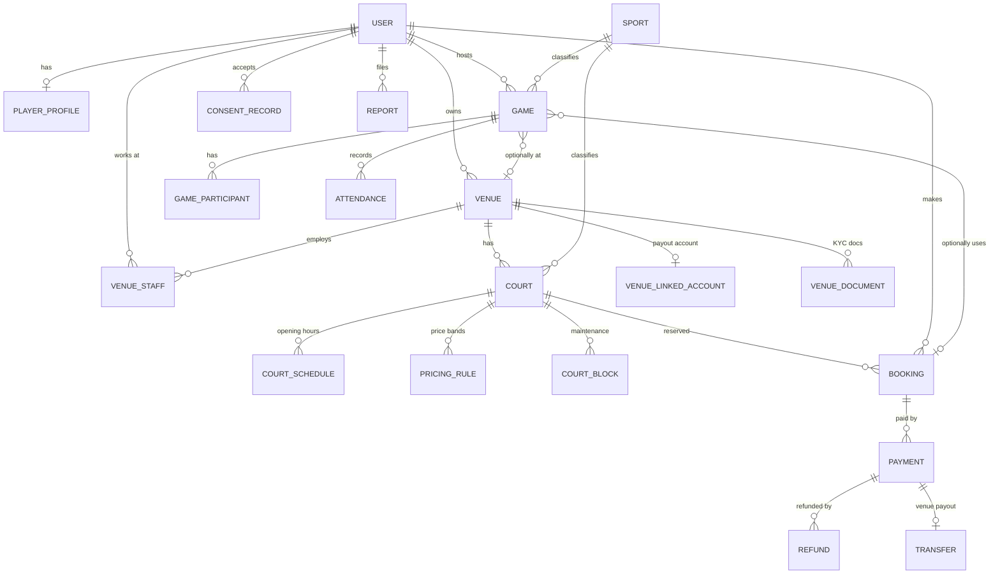
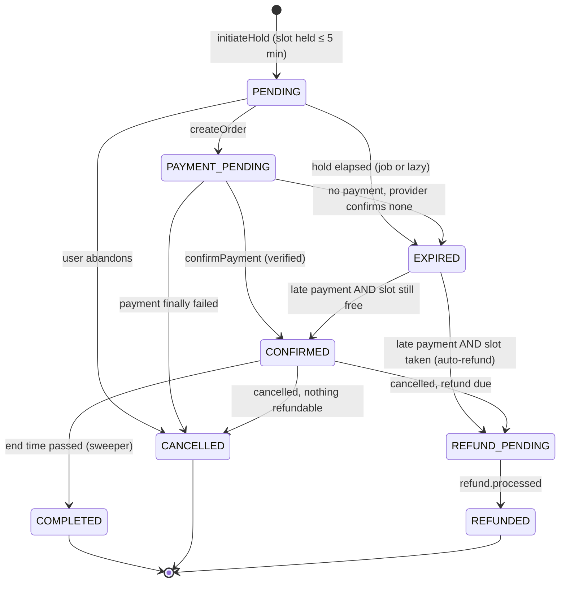
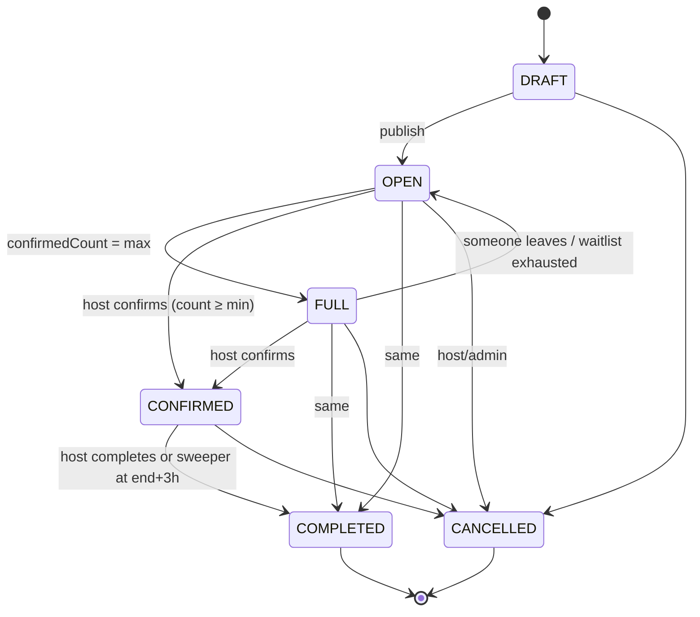
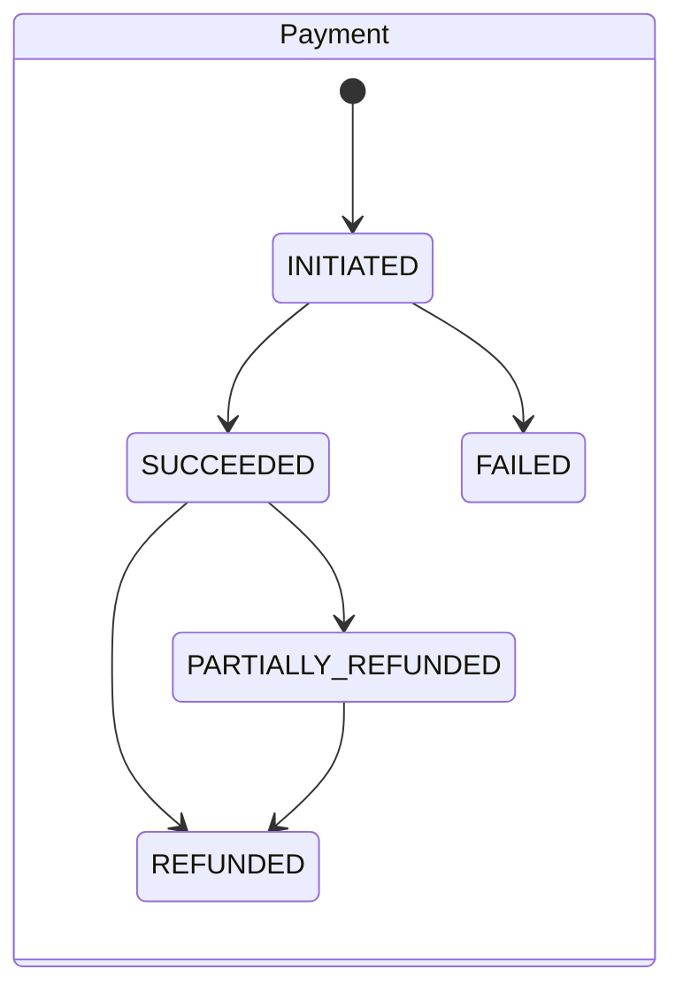
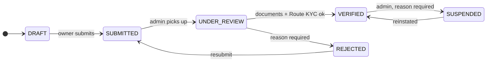

# 03 · Data Model

| | |
|---|---|
| **Status** | v2.0 — schema machine-validated (`prisma validate`) and integrity SQL executed against a real Postgres engine (see §5.3) |
| **Audience** | Backend engineers, DBAs, QA, anyone writing reports |
| **Related** | [02-architecture](./02-architecture.md) · [04-api-specification](./04-api-specification.md) · [05-business-logic](./05-business-logic.md) |

---

## 1. Conventions

| Topic | Rule |
|---|---|
| Engine | PostgreSQL 16+ with `postgis` and `btree_gist`. Hosted on Neon (pooled URL for the app, direct URL for migrations). |
| ORM | Prisma. The schema below is validated on **Prisma 6.x**. If the project starts on Prisma 7, move the datasource URLs into `prisma.config.ts`, use the Postgres driver adapter, and re-run `prisma validate`; the models themselves do not change. Pin one major version in Sprint 0. |
| Naming | Tables: snake_case plural via `@@map`. **Columns keep Prisma's camelCase** (no per-field `@map`), so **raw SQL must double-quote identifiers** (`"startTime"`). v1's raw geo query used `base_hourly_rate_paise` and would have failed at runtime. |
| Time | Every instant is `timestamptz(3)`, stored in UTC. Intervals are half-open `[start, end)`. Business-local concepts (court opening hours, pricing bands) are stored as **minutes after local midnight in `Asia/Kolkata`** plus an ISO weekday, because they are wall-clock rules, not instants. |
| Money | `Int` paise. No floats, no decimals. Every money column is named `…Paise`. |
| IDs | `cuid(2)` primary keys. Public share codes and human-readable references are separate columns (`Game.shareCode`, `Booking.bookingNumber` from a sequence). |
| Deletion | Users are **anonymised**, never hard-deleted (`deletedAt`, PII nulled) because payments and bookings must be retained. Financial FKs are `Restrict`. `audit_logs` is append-only (trigger). |
| Enums | Postgres enums via Prisma. Adding a value is a safe additive migration; removing one is a multi-step migration. |
| Phasing | Phase 1 tables are created in the first migration. Models marked *Phase 2/3* are in the schema file for review but their tables are created when the phase starts (split them into a later migration). |

## 2. Entity relationship overview



Key relationship rules (carried over from the product plan and made precise):

- A **booking** reserves one court for one half-open interval. A **game** *may* reference a booking and a venue; a booking may exist with no game. Their lifecycles never share a state column.
- **Attendance** is distinct from **registration** (`GameParticipant`). Reliability is derived from attendance, never from registration.
- **Payments** attach to a purpose (`COURT_BOOKING` now; `TOURNAMENT_ENTRY`, `SUBSCRIPTION` later) and are traceable to a booking, an order ID and a provider payment ID.
- A user's *platform* roles are global (`PlatformRole[]`). *Venue* roles live on `VenueStaff` and *community* roles on `CommunityMember`. v1 mixed `VENUE_OWNER`/`VENUE_STAFF` into the global role enum, which made "owner of **which** venue?" unanswerable.

## 3. Entity catalogue

| Entity | Phase | Purpose | Invariants worth knowing |
|---|---|---|---|
| `User` | 1 | Identity | `phone` E.164 or `email` required; `deletedAt` marks anonymised accounts |
| `PlayerProfile` | 1 | Sport preferences, coarse location, privacy toggles | Location stored rounded to ~1 km; no reliability score column in Phase 1 |
| `ConsentRecord` | 1 | Evidence of accepted legal documents per version | Unique per user/document/version |
| `UserBlock`, `Report` | 1 | Trust & safety | Reports are moderated in admin; blocks hide users from each other |
| `AuditLog` | 1 | Append-only trace of admin and system actions | UPDATE/DELETE blocked by trigger; `reason` required for sensitive actions |
| `PlatformConfig` | 1 | Versioned business config (fees, commission, refund tiers) | Bookings snapshot the resulting amounts; config edits never rewrite history |
| `Sport` | 1 | Supported sports | Badminton only at launch |
| `Venue`, `VenueStaff`, `VenueDocument`, `VenueLinkedAccount` | 1 | Supply side, onboarding and payouts | `status` moves Draft → Submitted → Under review → Verified; only `VERIFIED` venues are searchable |
| `Court`, `CourtSchedule`, `PricingRule`, `CourtBlock` | 1 | Bookable resource and its rules | Availability is **computed** from these + bookings (no pre-generated slot rows) |
| `Booking` | 1 | A reservation of one court for one interval | `bookings_no_overlap` exclusion constraint; immutable price snapshot |
| `Payment`, `Refund`, `Transfer` | 1 | Money movement | At most one successful payment per booking; refunds cannot exceed the payment (service-enforced under row lock) |
| `WebhookEvent` | 1 | Idempotent inbox for provider callbacks | Unique `(provider, eventId)` |
| `OutboxJob` | 1 | Transactional outbox for jobs and notifications | Unique `dedupeKey` |
| `Game`, `GameParticipant`, `Attendance` | 1 | Playing sessions | `confirmedCount` includes the host and is mutated only by atomic SQL; CHECK keeps it within capacity |
| `Notification` | 1 | In-app notification feed | Delivery to SMS/push/WhatsApp is via `OutboxJob` |
| `Review`, `ReliabilitySnapshot` | 2 | Feedback and computed reliability | One review per author/target/game |
| `Community`, `CommunityMember` | 2 | Clubs | |
| `Achievement`, `UserAchievement` | 2 | XP and badges | One award per user/achievement |
| `Tournament`, `TournamentEntry` | 3 | Competitions | Entry fees will use `Payment` with a new purpose |
| `Subscription` | 3 | Venue plans | |

### 3.1 Why availability is computed, not stored

v1 had two incompatible designs: an `AvailabilitySlot` table with a one-to-one booking link, and a scheduler that hard-coded 06:00–22:00 hourly slots and ignored that table. v2 keeps one model:

```text
available(court, [s,e))  =  inside an opening window (CourtSchedule)
                        AND no CourtBlock overlaps
                        AND no live Booking overlaps
price(court, [s,e))      =  Σ over slot grid: highest-priority matching PricingRule, else Court.baseHourlyRatePaise
live(booking)            =  status ∈ {CONFIRMED, COMPLETED, PAYMENT_PENDING}
                            OR (status = PENDING AND holdExpiresAt > now())
```

Pre-generating rows would need a nightly job, would drift from rule edits, and still would not stop overlaps without a constraint. Computed availability is a handful of indexed range reads per court-day.

---

## 4. Prisma schema

Source of truth: `packages/db/prisma/schema.prisma`. The text below was validated with `prisma validate` and used to generate DDL for the tests in §5.3.

```prisma
// packages/db/prisma/schema.prisma
// Validated with Prisma 6.x. See docs/03-data-model.md for conventions and the raw-SQL migration.

generator client {
  provider        = "prisma-client-js"
  previewFeatures = ["postgresqlExtensions"]
}

datasource db {
  provider   = "postgresql"
  url        = env("DATABASE_URL")
  directUrl  = env("DIRECT_DATABASE_URL")
  extensions = [postgis, btree_gist]
}

// ───────────────────────── ENUMS ─────────────────────────

enum UserStatus {
  ACTIVE
  SUSPENDED
  DEACTIVATED
}

enum PlatformRole {
  PLAYER
  SUPPORT_AGENT
  MODERATOR
  ADMINISTRATOR
}

enum VenueRole {
  OWNER
  MANAGER
  STAFF
}

enum SkillLevel {
  BEGINNER
  INTERMEDIATE
  ADVANCED
  COMPETITIVE
}

enum SportFormat {
  SINGLES
  DOUBLES
  ANY
}

enum GameStatus {
  DRAFT
  OPEN
  FULL
  CONFIRMED
  COMPLETED
  CANCELLED
}

enum GameVisibility {
  PUBLIC
  PRIVATE_INVITE
  COMMUNITY_ONLY
}

enum JoinPolicy {
  OPEN
  APPROVAL
}

enum ParticipantStatus {
  INVITED
  REQUESTED
  CONFIRMED
  WAITLISTED
  DECLINED
  LEFT
  REMOVED
}

enum AttendanceStatus {
  PENDING
  ATTENDED
  NO_SHOW
  EXCUSED
}

enum VenueStatus {
  DRAFT
  SUBMITTED
  UNDER_REVIEW
  VERIFIED
  REJECTED
  SUSPENDED
}

enum DocumentType {
  ID_PROOF
  BUSINESS_PROOF
  ADDRESS_PROOF
  GST_CERTIFICATE
  PHOTO
}

enum DocumentStatus {
  SUBMITTED
  APPROVED
  REJECTED
}

enum KycStatus {
  NOT_STARTED
  PENDING
  ACTIVATED
  NEEDS_CLARIFICATION
  REJECTED
}

enum BookingStatus {
  PENDING
  PAYMENT_PENDING
  CONFIRMED
  COMPLETED
  CANCELLED
  EXPIRED
  REFUND_PENDING
  REFUNDED
}

enum CancelledBy {
  USER
  VENUE
  ADMIN
  SYSTEM
}

enum PaymentPurpose {
  COURT_BOOKING
}

enum PaymentStatus {
  INITIATED
  SUCCEEDED
  FAILED
  PARTIALLY_REFUNDED
  REFUNDED
}

enum PaymentMethod {
  UPI
  CARD
  NETBANKING
  WALLET
  OTHER
}

enum RefundStatus {
  INITIATED
  PROCESSED
  FAILED
}

enum TransferStatus {
  PENDING
  PROCESSED
  SETTLED
  REVERSED
  FAILED
}

enum WebhookStatus {
  RECEIVED
  PROCESSED
  IGNORED
  FAILED
}

enum OutboxStatus {
  PENDING
  DISPATCHED
  DONE
  FAILED
}

enum NotificationType {
  GAME_INVITATION
  GAME_JOIN_REQUEST
  GAME_JOINED
  GAME_CONFIRMED
  GAME_CANCELLED
  GAME_UPDATED
  BOOKING_CONFIRMED
  BOOKING_CANCELLED
  PAYMENT_SUCCESS
  REFUND_PROCESSED
  MATCH_REMINDER
  COMMUNITY_ANNOUNCEMENT
}

enum ConsentDocument {
  TERMS
  PRIVACY
  REFUND_POLICY
  CANCELLATION_POLICY
  COMMUNITY_GUIDELINES
}

enum ReportEntity {
  GAME
  USER
  VENUE
  COMMUNITY
  REVIEW
}

enum ReportStatus {
  OPEN
  IN_REVIEW
  ACTIONED
  DISMISSED
}

enum ActorType {
  USER
  SYSTEM
  WEBHOOK
}

// Phase 2 / 3 enums
enum CommunityVisibility {
  PUBLIC
  PRIVATE
}

enum CommunityRole {
  MEMBER
  MODERATOR
  ADMIN
}

enum TournamentFormat {
  SINGLE_ELIMINATION
  DOUBLE_ELIMINATION
  ROUND_ROBIN
  LEAGUE
}

enum TournamentStatus {
  DRAFT
  REGISTRATION_OPEN
  REGISTRATION_CLOSED
  IN_PROGRESS
  COMPLETED
  CANCELLED
}

enum AchievementCategory {
  PARTICIPATION
  RELIABILITY
  COMMUNITY
  COMPETITION
}

// ───────────────── IDENTITY, TRUST & SAFETY ─────────────────

model User {
  id              String         @id @default(cuid(2))
  phone           String?        @unique // E.164, e.g. +919812345678 (CHECK-constrained in raw SQL)
  phoneVerifiedAt DateTime?      @db.Timestamptz(3)
  email           String?        @unique
  name            String?
  avatarUrl       String?
  status          UserStatus     @default(ACTIVE)
  platformRoles   PlatformRole[] @default([PLAYER])
  preferredLang   String         @default("en")
  ageConfirmedAt  DateTime?      @db.Timestamptz(3) // 18+ self-declaration (see ADR-015)
  deletedAt       DateTime?      @db.Timestamptz(3) // anonymised, not hard-deleted
  createdAt       DateTime       @default(now()) @db.Timestamptz(3)
  updatedAt       DateTime       @updatedAt @db.Timestamptz(3)

  playerProfile PlayerProfile?
  venueStaff    VenueStaff[]
  ownedVenues   Venue[]              @relation("VenueOwner")
  bookings      Booking[]
  payments      Payment[]
  hostedGames   Game[]               @relation("HostGames")
  participation GameParticipant[]
  attendances   Attendance[]
  notifications Notification[]
  consents      ConsentRecord[]
  blocksMade    UserBlock[]          @relation("Blocker")
  blocksHad     UserBlock[]          @relation("Blocked")
  reportsMade   Report[]             @relation("Reporter")
  auditEntries  AuditLog[]
  reviewsGiven  Review[]             @relation("ReviewAuthor")
  reviewsGotten Review[]             @relation("ReviewTarget")
  communities   CommunityMember[]
  createdComms  Community[]          @relation("CommunityCreator")
  organized     Tournament[]
  entries       TournamentEntry[]
  achievements  UserAchievement[]
  reliability   ReliabilitySnapshot?

  @@map("users")
}

model PlayerProfile {
  id                String      @id @default(cuid(2))
  userId            String      @unique
  user              User        @relation(fields: [userId], references: [id], onDelete: Cascade)
  city              String      @default("Sirsa")
  neighborhood      String?
  approxLatitude    Float? // rounded to 2 dp (~1.1 km) — never store precise home location
  approxLongitude   Float?
  searchRadiusKm    Int         @default(10)
  preferredSportId  String?
  skillLevel        SkillLevel  @default(BEGINNER)
  preferredFormat   SportFormat @default(DOUBLES)
  bio               String?     @db.VarChar(300)
  availability      Json? // [{ day: 1..7, fromMinute, toMinute }]
  discoverable      Boolean     @default(true)
  showAttendance    Boolean     @default(true)
  notificationPrefs Json        @default("{}")
  xpPoints          Int         @default(0) // Phase 2
  currentLevel      Int         @default(1) // Phase 2
  createdAt         DateTime    @default(now()) @db.Timestamptz(3)
  updatedAt         DateTime    @updatedAt @db.Timestamptz(3)

  @@index([city, skillLevel])
  @@map("player_profiles")
}

model ConsentRecord {
  id         String          @id @default(cuid(2))
  userId     String
  user       User            @relation(fields: [userId], references: [id], onDelete: Cascade)
  document   ConsentDocument
  version    String // e.g. "2026-11-01"
  acceptedAt DateTime        @default(now()) @db.Timestamptz(3)
  ipHash     String? // salted hash, not raw IP

  @@unique([userId, document, version])
  @@map("consent_records")
}

model UserBlock {
  id        String   @id @default(cuid(2))
  blockerId String
  blocker   User     @relation("Blocker", fields: [blockerId], references: [id], onDelete: Cascade)
  blockedId String
  blocked   User     @relation("Blocked", fields: [blockedId], references: [id], onDelete: Cascade)
  createdAt DateTime @default(now()) @db.Timestamptz(3)

  @@unique([blockerId, blockedId])
  @@map("user_blocks")
}

model Report {
  id             String       @id @default(cuid(2))
  reporterId     String
  reporter       User         @relation("Reporter", fields: [reporterId], references: [id], onDelete: Cascade)
  entityType     ReportEntity
  entityId       String
  reason         String
  details        String?      @db.VarChar(1000)
  status         ReportStatus @default(OPEN)
  resolvedById   String?
  resolutionNote String?
  createdAt      DateTime     @default(now()) @db.Timestamptz(3)
  resolvedAt     DateTime?    @db.Timestamptz(3)

  @@index([status, createdAt])
  @@index([entityType, entityId])
  @@map("reports")
}

model AuditLog {
  id         String    @id @default(cuid(2))
  actorType  ActorType @default(USER)
  actorId    String?
  actor      User?     @relation(fields: [actorId], references: [id], onDelete: Restrict)
  action     String // e.g. VENUE_VERIFIED, USER_SUSPENDED, BOOKING_FORCE_CANCELLED
  entityType String
  entityId   String
  before     Json?
  after      Json?
  reason     String? // mandatory for sensitive admin actions (enforced in service layer)
  ipAddress  String?
  requestId  String?
  createdAt  DateTime  @default(now()) @db.Timestamptz(3)

  @@index([entityType, entityId])
  @@index([actorId, createdAt])
  @@map("audit_logs")
}

model PlatformConfig {
  key         String   @id // e.g. "pricing"
  value       Json
  version     Int      @default(1)
  updatedById String?
  updatedAt   DateTime @updatedAt @db.Timestamptz(3)

  @@map("platform_config")
}

// ───────────────────── SPORTS, VENUES, COURTS ─────────────────────

model Sport {
  id         String       @id @default(cuid(2))
  slug       String       @unique
  name       String
  minPlayers Int          @default(2)
  maxPlayers Int          @default(4)
  isActive   Boolean      @default(true)
  courts     Court[]
  games      Game[]
  tournament Tournament[]

  @@map("sports")
}

model Venue {
  id               String      @id @default(cuid(2))
  name             String
  slug             String      @unique
  legalName        String?
  gstin            String?
  description      String?     @db.Text
  addressLine1     String
  addressLine2     String?
  city             String      @default("Sirsa")
  state            String      @default("Haryana")
  postalCode       String      @default("125055")
  latitude         Float
  longitude        Float
  phone            String
  email            String?
  images           String[]    @default([])
  amenities        String[]    @default([])
  cancellationRule String?     @db.Text // human-readable; machine policy lives in cancellationPolicy
  cancellationPolicy Json? // optional override of the default refund tiers (see 05 §2.5)
  status           VenueStatus @default(DRAFT)
  rejectionReason  String?
  verifiedAt       DateTime?   @db.Timestamptz(3)
  publishedAt      DateTime?   @db.Timestamptz(3)
  ownerId          String
  owner            User        @relation("VenueOwner", fields: [ownerId], references: [id], onDelete: Restrict)
  createdAt        DateTime    @default(now()) @db.Timestamptz(3)
  updatedAt        DateTime    @updatedAt @db.Timestamptz(3)

  staff         VenueStaff[]
  documents     VenueDocument[]
  linkedAccount VenueLinkedAccount?
  courts        Court[]
  games         Game[]
  transfers     Transfer[]
  reviews       Review[]
  subscriptions Subscription[]

  @@index([city, status])
  @@map("venues")
}

model VenueStaff {
  id        String    @id @default(cuid(2))
  venueId   String
  venue     Venue     @relation(fields: [venueId], references: [id], onDelete: Cascade)
  userId    String
  user      User      @relation(fields: [userId], references: [id], onDelete: Cascade)
  role      VenueRole @default(STAFF)
  createdAt DateTime  @default(now()) @db.Timestamptz(3)

  @@unique([venueId, userId])
  @@map("venue_staff")
}

model VenueDocument {
  id           String         @id @default(cuid(2))
  venueId      String
  venue        Venue          @relation(fields: [venueId], references: [id], onDelete: Cascade)
  type         DocumentType
  storageKey   String // key in the PRIVATE R2 bucket; served via short-lived signed URL only
  status       DocumentStatus @default(SUBMITTED)
  reviewerId   String?
  reviewNote   String?
  createdAt    DateTime       @default(now()) @db.Timestamptz(3)
  reviewedAt   DateTime?      @db.Timestamptz(3)

  @@index([venueId, status])
  @@map("venue_documents")
}

model VenueLinkedAccount {
  id                String    @id @default(cuid(2))
  venueId           String    @unique
  venue             Venue     @relation(fields: [venueId], references: [id], onDelete: Cascade)
  razorpayAccountId String    @unique // Route linked account; bank details are held by Razorpay, never by us
  kycStatus         KycStatus @default(NOT_STARTED)
  updatedAt         DateTime  @updatedAt @db.Timestamptz(3)

  @@map("venue_linked_accounts")
}

model Court {
  id                  String  @id @default(cuid(2))
  venueId             String
  venue               Venue   @relation(fields: [venueId], references: [id], onDelete: Cascade)
  sportId             String
  sport               Sport   @relation(fields: [sportId], references: [id])
  name                String
  surfaceType         String?
  isIndoor            Boolean @default(true)
  isActive            Boolean @default(true)
  baseHourlyRatePaise Int
  slotMinutes         Int     @default(60) // grid granularity
  minDurationMinutes  Int     @default(60)
  maxDurationMinutes  Int     @default(120)
  advanceBookingDays  Int     @default(14)
  createdAt           DateTime @default(now()) @db.Timestamptz(3)
  updatedAt           DateTime @updatedAt @db.Timestamptz(3)

  schedule     CourtSchedule[]
  pricingRules PricingRule[]
  blocks       CourtBlock[]
  bookings     Booking[]

  @@index([venueId, isActive])
  @@map("courts")
}

// Weekly operating windows. A court may have several windows per day (split shifts).
model CourtSchedule {
  id          String @id @default(cuid(2))
  courtId     String
  court       Court  @relation(fields: [courtId], references: [id], onDelete: Cascade)
  dayOfWeek   Int // ISO: 1 = Monday … 7 = Sunday
  openMinute  Int // minutes after local midnight (Asia/Kolkata), 0–1440
  closeMinute Int

  @@unique([courtId, dayOfWeek, openMinute])
  @@map("court_schedules")
}

// Time-band pricing. Highest `priority` wins; fallback is Court.baseHourlyRatePaise.
model PricingRule {
  id              String    @id @default(cuid(2))
  courtId         String
  court           Court     @relation(fields: [courtId], references: [id], onDelete: Cascade)
  name            String // "Weekday evening peak"
  daysOfWeek      Int[] // ISO 1–7
  startMinute     Int
  endMinute       Int
  hourlyRatePaise Int
  priority        Int       @default(0)
  validFrom       DateTime? @db.Date
  validTo         DateTime? @db.Date

  @@index([courtId])
  @@map("pricing_rules")
}

model CourtBlock {
  id          String   @id @default(cuid(2))
  courtId     String
  court       Court    @relation(fields: [courtId], references: [id], onDelete: Cascade)
  startTime   DateTime @db.Timestamptz(3)
  endTime     DateTime @db.Timestamptz(3)
  reason      String?
  createdById String
  createdAt   DateTime @default(now()) @db.Timestamptz(3)

  @@index([courtId, startTime])
  @@map("court_blocks")
}

// ─────────────── BOOKINGS, PAYMENTS, SETTLEMENT ───────────────
// The no-overlap guarantee is an EXCLUDE constraint in raw SQL (see migration 0002).

model Booking {
  id            String        @id @default(cuid(2))
  bookingNumber String        @unique @default(dbgenerated("('BK-' || to_char(now() AT TIME ZONE 'Asia/Kolkata', 'YYYY') || '-' || lpad(nextval('booking_number_seq')::text, 6, '0'))"))
  userId        String
  user          User          @relation(fields: [userId], references: [id], onDelete: Restrict)
  courtId       String
  court         Court         @relation(fields: [courtId], references: [id], onDelete: Restrict)
  startTime     DateTime      @db.Timestamptz(3)
  endTime       DateTime      @db.Timestamptz(3)
  status        BookingStatus @default(PENDING)
  holdExpiresAt DateTime?     @db.Timestamptz(3)
  idempotencyKey String       @unique

  // Immutable price snapshot, calculated once at reservation by packages/domain/fees.ts
  baseAmountPaise          Int
  convenienceFeePaise      Int  @default(0)
  gstOnConvenienceFeePaise Int  @default(0)
  discountPaise            Int  @default(0)
  totalAmountPaise         Int
  commissionPaise          Int  @default(0) // platform commission, deducted from venue payout
  gstOnCommissionPaise     Int  @default(0)
  venuePayoutPaise         Int
  pricingConfigVersion     Int

  confirmedAt        DateTime?   @db.Timestamptz(3)
  completedAt        DateTime?   @db.Timestamptz(3)
  cancelledAt        DateTime?   @db.Timestamptz(3)
  cancelledBy        CancelledBy?
  cancellationReason String?
  createdAt          DateTime    @default(now()) @db.Timestamptz(3)
  updatedAt          DateTime    @updatedAt @db.Timestamptz(3)

  game     Game?
  payments Payment[]

  @@index([userId, status])
  @@index([courtId, startTime])
  @@index([status, holdExpiresAt])
  @@map("bookings")
}

model Payment {
  id                String         @id @default(cuid(2))
  paymentNumber     String         @unique @default(dbgenerated("('PAY-' || to_char(now() AT TIME ZONE 'Asia/Kolkata', 'YYYY') || '-' || lpad(nextval('payment_number_seq')::text, 6, '0'))"))
  purpose           PaymentPurpose @default(COURT_BOOKING)
  bookingId         String?
  booking           Booking?       @relation(fields: [bookingId], references: [id], onDelete: Restrict)
  userId            String
  user              User           @relation(fields: [userId], references: [id], onDelete: Restrict)
  amountPaise       Int
  status            PaymentStatus  @default(INITIATED)
  method            PaymentMethod?
  razorpayOrderId   String         @unique
  razorpayPaymentId String?        @unique
  idempotencyKey    String         @unique
  failureCode       String?
  failureReason     String?
  capturedAt        DateTime?      @db.Timestamptz(3)
  createdAt         DateTime       @default(now()) @db.Timestamptz(3)
  updatedAt         DateTime       @updatedAt @db.Timestamptz(3)

  refunds  Refund[]
  transfer Transfer?

  @@index([bookingId])
  @@index([status, createdAt])
  @@map("payments")
}

model Refund {
  id               String       @id @default(cuid(2))
  paymentId        String
  payment          Payment      @relation(fields: [paymentId], references: [id], onDelete: Restrict)
  amountPaise      Int
  policyTier       String? // e.g. "GT_24H", "H12_24", "LT_12H", "VENUE_CANCELLED"
  reason           String?
  status           RefundStatus @default(INITIATED)
  razorpayRefundId String?      @unique
  idempotencyKey   String       @unique
  requestedById    String?
  processedAt      DateTime?    @db.Timestamptz(3)
  createdAt        DateTime     @default(now()) @db.Timestamptz(3)

  @@index([paymentId])
  @@map("refunds")
}

// One Razorpay Route transfer per payment (venue payout leg).
model Transfer {
  id                 String         @id @default(cuid(2))
  paymentId          String         @unique
  payment            Payment        @relation(fields: [paymentId], references: [id], onDelete: Restrict)
  venueId            String
  venue              Venue          @relation(fields: [venueId], references: [id], onDelete: Restrict)
  amountPaise        Int
  reversedPaise      Int            @default(0)
  razorpayTransferId String?        @unique
  status             TransferStatus @default(PENDING)
  settledAt          DateTime?      @db.Timestamptz(3)
  createdAt          DateTime       @default(now()) @db.Timestamptz(3)
  updatedAt          DateTime       @updatedAt @db.Timestamptz(3)

  @@index([venueId, status])
  @@map("transfers")
}

model WebhookEvent {
  id          String        @id @default(cuid(2))
  provider    String // "razorpay"
  eventId     String // provider event id (x-razorpay-event-id)
  type        String
  payload     Json
  status      WebhookStatus @default(RECEIVED)
  attempts    Int           @default(0)
  error       String?
  receivedAt  DateTime      @default(now()) @db.Timestamptz(3)
  processedAt DateTime?     @db.Timestamptz(3)

  @@unique([provider, eventId])
  @@index([status, receivedAt])
  @@map("webhook_events")
}

model OutboxJob {
  id           String       @id @default(cuid(2))
  type         String // "booking.expire", "game.reminder", "notification.deliver", …
  payload      Json
  dedupeKey    String       @unique
  runAt        DateTime     @default(now()) @db.Timestamptz(3)
  status       OutboxStatus @default(PENDING)
  attempts     Int          @default(0)
  lastError    String?
  dispatchedAt DateTime?    @db.Timestamptz(3)
  createdAt    DateTime     @default(now()) @db.Timestamptz(3)

  @@index([status, runAt])
  @@map("outbox_jobs")
}

// ───────────────────── GAMES & PARTICIPATION ─────────────────────
// Lifecycle is independent of Booking. A confirmed court is Game.bookingId != null.

model Game {
  id                 String         @id @default(cuid(2))
  shareCode          String         @unique // 8-char base32 for public share links
  title              String         @db.VarChar(120)
  sportId            String
  sport              Sport          @relation(fields: [sportId], references: [id])
  hostId             String
  host               User           @relation("HostGames", fields: [hostId], references: [id], onDelete: Restrict)
  venueId            String?
  venue              Venue?         @relation(fields: [venueId], references: [id], onDelete: SetNull)
  bookingId          String?        @unique
  booking            Booking?       @relation(fields: [bookingId], references: [id], onDelete: SetNull)
  communityId        String?
  community          Community?     @relation(fields: [communityId], references: [id], onDelete: SetNull)
  startTime          DateTime       @db.Timestamptz(3)
  endTime            DateTime       @db.Timestamptz(3)
  format             SportFormat    @default(DOUBLES)
  minSkillLevel      SkillLevel     @default(BEGINNER)
  maxSkillLevel      SkillLevel     @default(COMPETITIVE)
  minParticipants    Int            @default(2)
  maxParticipants    Int            @default(4)
  confirmedCount     Int            @default(1) // includes host; mutated ONLY by atomic SQL (05 §3)
  costPerPlayerPaise Int            @default(0) // informational; collected off-platform in Phase 1 (ADR-010)
  joinPolicy         JoinPolicy     @default(OPEN)
  visibility         GameVisibility @default(PUBLIC)
  status             GameStatus     @default(OPEN)
  customLocationName String?
  rulesDescription   String?        @db.Text
  cancelledReason    String?
  createdAt          DateTime       @default(now()) @db.Timestamptz(3)
  updatedAt          DateTime       @updatedAt @db.Timestamptz(3)

  participants GameParticipant[]
  attendances  Attendance[]
  reviews      Review[]

  @@index([sportId, status, startTime])
  @@index([hostId])
  @@index([venueId, startTime])
  @@map("games")
}

model GameParticipant {
  id            String            @id @default(cuid(2))
  gameId        String
  game          Game              @relation(fields: [gameId], references: [id], onDelete: Cascade)
  userId        String
  user          User              @relation(fields: [userId], references: [id], onDelete: Cascade)
  isHost        Boolean           @default(false)
  status        ParticipantStatus @default(CONFIRMED)
  hostMarkedPaid Boolean          @default(false)
  joinedAt      DateTime          @default(now()) @db.Timestamptz(3)
  leftAt        DateTime?         @db.Timestamptz(3)
  updatedAt     DateTime          @updatedAt @db.Timestamptz(3)

  @@unique([gameId, userId])
  @@index([userId, status])
  @@map("game_participants")
}

model Attendance {
  id         String           @id @default(cuid(2))
  gameId     String
  game       Game             @relation(fields: [gameId], references: [id], onDelete: Cascade)
  userId     String
  user       User             @relation(fields: [userId], references: [id], onDelete: Cascade)
  status     AttendanceStatus @default(PENDING)
  markedById String?
  markedAt   DateTime?        @db.Timestamptz(3)
  notes      String?

  @@unique([gameId, userId])
  @@index([userId, status])
  @@map("attendances")
}

model Notification {
  id        String           @id @default(cuid(2))
  userId    String
  user      User             @relation(fields: [userId], references: [id], onDelete: Cascade)
  type      NotificationType
  title     String
  body      String
  linkUrl   String?
  dedupeKey String?          @unique
  readAt    DateTime?        @db.Timestamptz(3)
  createdAt DateTime         @default(now()) @db.Timestamptz(3)

  @@index([userId, readAt, createdAt])
  @@map("notifications")
}

// ──────────────── PHASE 2 / 3 (create tables when the phase starts) ────────────────

model Review {
  id           String   @id @default(cuid(2))
  authorId     String
  author       User     @relation("ReviewAuthor", fields: [authorId], references: [id], onDelete: Cascade)
  gameId       String?
  game         Game?    @relation(fields: [gameId], references: [id], onDelete: SetNull)
  targetUserId String?
  targetUser   User?    @relation("ReviewTarget", fields: [targetUserId], references: [id], onDelete: Cascade)
  venueId      String?
  venue        Venue?   @relation(fields: [venueId], references: [id], onDelete: Cascade)
  rating       Int // 1–5 (CHECK-constrained)
  comment      String?  @db.VarChar(1000)
  isHidden     Boolean  @default(false)
  createdAt    DateTime @default(now()) @db.Timestamptz(3)

  // A review must reference a real shared game; one review per author/target/game.
  @@unique([authorId, gameId, targetUserId])
  @@index([targetUserId])
  @@index([venueId])
  @@map("reviews")
}

model ReliabilitySnapshot {
  id           String   @id @default(cuid(2))
  userId       String   @unique
  user         User     @relation(fields: [userId], references: [id], onDelete: Cascade)
  score        Int // 0–100, formula in 05 §6.2
  sampleSize   Int
  attended     Int
  noShows      Int
  lateCancels  Int
  computedAt   DateTime @default(now()) @db.Timestamptz(3)

  @@map("reliability_snapshots")
}

model Community {
  id          String              @id @default(cuid(2))
  name        String              @unique
  slug        String              @unique
  description String?             @db.Text
  city        String              @default("Sirsa")
  creatorId   String
  creator     User                @relation("CommunityCreator", fields: [creatorId], references: [id], onDelete: Restrict)
  visibility  CommunityVisibility @default(PUBLIC)
  avatarUrl   String?
  memberCount Int                 @default(1)
  createdAt   DateTime            @default(now()) @db.Timestamptz(3)
  updatedAt   DateTime            @updatedAt @db.Timestamptz(3)

  members CommunityMember[]
  games   Game[]

  @@index([city, visibility])
  @@map("communities")
}

model CommunityMember {
  id          String        @id @default(cuid(2))
  communityId String
  community   Community     @relation(fields: [communityId], references: [id], onDelete: Cascade)
  userId      String
  user        User          @relation(fields: [userId], references: [id], onDelete: Cascade)
  role        CommunityRole @default(MEMBER)
  joinedAt    DateTime      @default(now()) @db.Timestamptz(3)

  @@unique([communityId, userId])
  @@map("community_members")
}

model Tournament {
  id            String           @id @default(cuid(2))
  title         String
  slug          String           @unique
  sportId       String
  sport         Sport            @relation(fields: [sportId], references: [id])
  organizerId   String
  organizer     User             @relation(fields: [organizerId], references: [id])
  format        TournamentFormat @default(SINGLE_ELIMINATION)
  city          String           @default("Sirsa")
  startDate     DateTime         @db.Timestamptz(3)
  endDate       DateTime         @db.Timestamptz(3)
  entryFeePaise Int              @default(0)
  maxTeams      Int              @default(16)
  status        TournamentStatus @default(DRAFT)
  createdAt     DateTime         @default(now()) @db.Timestamptz(3)
  updatedAt     DateTime         @updatedAt @db.Timestamptz(3)

  entries TournamentEntry[]

  @@map("tournaments")
}

model TournamentEntry {
  id           String     @id @default(cuid(2))
  tournamentId String
  tournament   Tournament @relation(fields: [tournamentId], references: [id], onDelete: Cascade)
  userId       String
  user         User       @relation(fields: [userId], references: [id], onDelete: Cascade)
  teamName     String?
  seedNumber   Int?
  paymentId    String? // Phase 3: extend PaymentPurpose with TOURNAMENT_ENTRY
  createdAt    DateTime   @default(now()) @db.Timestamptz(3)

  @@unique([tournamentId, userId])
  @@map("tournament_entries")
}

model Achievement {
  id          String              @id @default(cuid(2))
  code        String              @unique
  title       String
  description String
  category    AchievementCategory
  xpReward    Int                 @default(50)
  badgeIcon   String

  awards UserAchievement[]

  @@map("achievements")
}

model UserAchievement {
  id            String      @id @default(cuid(2))
  userId        String
  user          User        @relation(fields: [userId], references: [id], onDelete: Cascade)
  achievementId String
  achievement   Achievement @relation(fields: [achievementId], references: [id], onDelete: Cascade)
  awardedAt     DateTime    @default(now()) @db.Timestamptz(3)

  @@unique([userId, achievementId])
  @@map("user_achievements")
}

model Subscription {
  id               String   @id @default(cuid(2))
  venueId          String
  venue            Venue    @relation(fields: [venueId], references: [id], onDelete: Cascade)
  planName         String // STARTER | GROWTH | ENTERPRISE
  amountPaise      Int
  isActive         Boolean  @default(true)
  currentPeriodEnd DateTime @db.Timestamptz(3)
  createdAt        DateTime @default(now()) @db.Timestamptz(3)

  @@map("subscriptions")
}
```

### 4.1 Migration order (important)

Prisma's generated DDL references two sequences in column defaults. Postgres resolves those at `CREATE TABLE`, so the sequences must exist first.

1. `prisma migrate dev --create-only --name init` to generate `0001_init`.
2. **Edit `0001_init/migration.sql`** and prepend:
   ```sql
   CREATE SEQUENCE IF NOT EXISTS booking_number_seq;
   CREATE SEQUENCE IF NOT EXISTS payment_number_seq;
   ```
3. Create `0002_integrity` by hand with the SQL in §5.1 (`prisma migrate dev --create-only --name integrity`, paste, save).
4. Apply with `prisma migrate deploy` (CI/production) — never `migrate dev` against a shared database.
5. After every future `migrate dev`, confirm Prisma does not propose to drop the hand-written constraints (it ignores `CHECK`, `EXCLUDE`, triggers and partial indexes it cannot model; verify once in Sprint 0 and record the result in the repo README).

Migration policy: **expand → migrate → contract**. Additive changes ship first; destructive changes ship in a later release after the code no longer uses them.

---

## 5. Database-enforced invariants

### 5.1 Integrity migration (`0002_integrity`)

```sql
-- packages/db/prisma/migrations/0002_integrity/migration.sql
-- Hand-written. Run AFTER the Prisma-generated DDL for the same schema version.
-- Identifiers are quoted camelCase because the Prisma schema does not @map columns.

-- ───────────── Bookings: the double-booking guarantee ─────────────
-- Two live bookings for the same court may never overlap. This is the real
-- guarantee; Redis holds and advisory locks only make failures cheap and polite.
ALTER TABLE "bookings"
  ADD CONSTRAINT "bookings_no_overlap"
  EXCLUDE USING gist (
    "courtId" WITH =,
    tstzrange("startTime", "endTime", '[)') WITH &&
  )
  WHERE ("status" IN ('PENDING', 'PAYMENT_PENDING', 'CONFIRMED', 'COMPLETED'));

ALTER TABLE "bookings"
  ADD CONSTRAINT "bookings_interval_valid"   CHECK ("endTime" > "startTime"),
  ADD CONSTRAINT "bookings_amounts_valid"    CHECK (
    "baseAmountPaise" > 0 AND "convenienceFeePaise" >= 0 AND "gstOnConvenienceFeePaise" >= 0
    AND "discountPaise" >= 0 AND "commissionPaise" >= 0 AND "gstOnCommissionPaise" >= 0
    AND "venuePayoutPaise" >= 0 AND "totalAmountPaise" > 0),
  ADD CONSTRAINT "bookings_total_consistent" CHECK (
    "totalAmountPaise" = "baseAmountPaise" + "convenienceFeePaise" + "gstOnConvenienceFeePaise" - "discountPaise"),
  ADD CONSTRAINT "bookings_payout_consistent" CHECK (
    "venuePayoutPaise" = "baseAmountPaise" - "commissionPaise" - "gstOnCommissionPaise"),
  ADD CONSTRAINT "bookings_pending_has_hold" CHECK (
    "status" <> 'PENDING' OR "holdExpiresAt" IS NOT NULL);

-- ───────────── Payments, refunds, transfers ─────────────
ALTER TABLE "payments"
  ADD CONSTRAINT "payments_amount_positive" CHECK ("amountPaise" > 0),
  ADD CONSTRAINT "payments_purpose_target"  CHECK ("purpose" <> 'COURT_BOOKING' OR "bookingId" IS NOT NULL);

-- At most one successful payment per booking (retries reuse the same order).
CREATE UNIQUE INDEX "payments_one_success_per_booking"
  ON "payments" ("bookingId")
  WHERE "status" IN ('SUCCEEDED', 'PARTIALLY_REFUNDED', 'REFUNDED');

ALTER TABLE "refunds"   ADD CONSTRAINT "refunds_amount_positive"   CHECK ("amountPaise" > 0);
ALTER TABLE "transfers" ADD CONSTRAINT "transfers_amounts_valid"   CHECK ("amountPaise" >= 0 AND "reversedPaise" BETWEEN 0 AND "amountPaise");

-- ───────────── Games ─────────────
ALTER TABLE "games"
  ADD CONSTRAINT "games_interval_valid"  CHECK ("endTime" > "startTime"),
  ADD CONSTRAINT "games_capacity_valid"  CHECK ("maxParticipants" >= 2 AND "minParticipants" BETWEEN 1 AND "maxParticipants"),
  ADD CONSTRAINT "games_count_in_range"  CHECK ("confirmedCount" BETWEEN 0 AND "maxParticipants"),
  ADD CONSTRAINT "games_cost_valid"      CHECK ("costPerPlayerPaise" >= 0);

-- ───────────── Court configuration ─────────────
ALTER TABLE "courts"
  ADD CONSTRAINT "courts_rate_valid"     CHECK ("baseHourlyRatePaise" > 0),
  ADD CONSTRAINT "courts_slot_valid"     CHECK ("slotMinutes" IN (15, 30, 60)),
  ADD CONSTRAINT "courts_duration_valid" CHECK (
    "minDurationMinutes" >= "slotMinutes" AND "maxDurationMinutes" >= "minDurationMinutes"
    AND "minDurationMinutes" % "slotMinutes" = 0 AND "maxDurationMinutes" % "slotMinutes" = 0);

ALTER TABLE "court_schedules"
  ADD CONSTRAINT "court_schedules_valid" CHECK (
    "dayOfWeek" BETWEEN 1 AND 7 AND "openMinute" >= 0 AND "closeMinute" <= 1440 AND "openMinute" < "closeMinute");

ALTER TABLE "pricing_rules"
  ADD CONSTRAINT "pricing_rules_valid" CHECK (
    "startMinute" >= 0 AND "endMinute" <= 1440 AND "startMinute" < "endMinute" AND "hourlyRatePaise" > 0);

ALTER TABLE "court_blocks"
  ADD CONSTRAINT "court_blocks_interval_valid" CHECK ("endTime" > "startTime");

-- ───────────── Users ─────────────
ALTER TABLE "users"
  ADD CONSTRAINT "users_has_identifier" CHECK ("phone" IS NOT NULL OR "email" IS NOT NULL),
  ADD CONSTRAINT "users_phone_e164"     CHECK ("phone" IS NULL OR "phone" ~ '^\+[1-9][0-9]{7,14}$');

-- ───────────── Audit log is append-only ─────────────
CREATE OR REPLACE FUNCTION forbid_mutation() RETURNS trigger LANGUAGE plpgsql AS $$
BEGIN
  RAISE EXCEPTION '% on % is not allowed (append-only table)', TG_OP, TG_TABLE_NAME;
END $$;

CREATE TRIGGER "audit_logs_append_only"
  BEFORE UPDATE OR DELETE ON "audit_logs"
  FOR EACH ROW EXECUTE FUNCTION forbid_mutation();
```

### 5.2 Who enforces what

| Invariant | Enforced by | Backstop |
|---|---|---|
| No two live bookings overlap on a court | **`bookings_no_overlap` (DB)** | Advisory lock (clean errors); Redis soft hold (instant UX) |
| Booking amounts add up | `bookings_total_consistent`, `bookings_payout_consistent` | `packages/domain/fees.ts` is the only producer |
| One successful payment per booking | Partial unique index | `confirmPayment()` idempotency |
| Webhook processed once | Unique `(provider, eventId)` | Idempotent handlers |
| Game never exceeds capacity | `games_count_in_range` + atomic `UPDATE … WHERE confirmedCount < maxParticipants` | Concurrency test T-05 |
| Court config sane | CHECK constraints | Zod validators |
| Audit trail immutable | Trigger | DB role without UPDATE/DELETE on `audit_logs` (production hardening) |
| Refunds ≤ payment | Service layer under `SELECT … FOR UPDATE` on the payment | Daily reconciliation query |
| Permissions and ownership | API layer (04 §3) | Row-level security is *not* used in MVP (see 07 §3.4) |

### 5.3 How this was verified

Reproduce with `cd docs/_verification && npm install && npm run test:sql` ([README](./_verification/README.md)).

The integrity migration above was executed against an embedded Postgres engine together with the DDL Prisma generates from the schema in §4 (PostGIS excluded because the engine lacks it). Twenty-one checks passed, including: overlapping and partially-overlapping bookings rejected; adjacent `[start,end)` bookings accepted; expiring a booking frees the slot; **reviving an expired booking is rejected once the slot has been re-taken**; inconsistent totals rejected; second successful payment per booking rejected; capacity cannot be exceeded by repeated atomic joins; audit log updates/deletes rejected; `hashtextextended` advisory locks accepted; booking numbers render as `BK-2026-000001`.

Not covered by that run (and therefore still to be proven on the real stack in Sprint 0): true multi-connection concurrency, PostGIS queries, and Neon pooler behaviour. Test T-01 in [08](./08-engineering-operations.md) covers concurrency against real Postgres.

---

## 6. State machines

### 6.1 Booking



| From → To | Trigger | Guard | Side effects (same transaction, via outbox) |
|---|---|---|---|
| ∅ → PENDING | `booking.initiateHold` | Within opening window, no block, within advance-booking limit, no live overlap | Schedule `booking.expire` at `holdExpiresAt` |
| PENDING → PAYMENT_PENDING | `payment.createOrder` | `holdExpiresAt` still in the future | Extend hold by up to 10 min (bounded, once); schedule `payment.reconcile` T+10 min |
| PAYMENT_PENDING → CONFIRMED | `confirmPayment()` | Provider says captured; **amount and currency equal the booking total**; order ID matches | Payment `SUCCEEDED`; create `Transfer`; notify player + venue |
| PENDING/PAYMENT_PENDING → EXPIRED | `booking.expire` | `holdExpiresAt` passed **and** provider shows no successful payment | Release Redis key |
| EXPIRED → CONFIRMED | Late webhook | Slot free (verified by the exclusion constraint on the UPDATE) | As above, plus audit entry `LATE_PAYMENT_REVIVED` |
| EXPIRED → REFUND_PENDING | Late webhook | Slot not free | Create refund for 100 % including convenience fee; notify player |
| CONFIRMED → CANCELLED / REFUND_PENDING | `booking.cancel`, venue cancel, admin cancel | Refund tier computed from time-to-start (05 §2.5) | Reverse Route transfer proportionally; create `Refund`; notify |
| CONFIRMED → COMPLETED | Sweeper | `now() > endTime` | Release linked game for completion prompts |

*In progress* is a **display state** (`startTime ≤ now < endTime`) derived at read time; v1 stored `IN_PROGRESS`, which required a cron to flip and was needed by no query.

### 6.2 Game (independent of booking)



- **Joinable** means `status ∈ {OPEN, CONFIRMED}` and `confirmedCount < maxParticipants` and `now < startTime`. A `CONFIRMED` game with free seats keeps accepting players without changing state. When full, new players go to the waitlist (`ParticipantStatus.WAITLISTED`).
- `COMPLETED` triggers attendance marking and feedback prompts. Attendance rows are created `PENDING` for every `CONFIRMED` participant.
- Cancelling a game never cancels or refunds a linked booking automatically; the host is asked (the booking may still be used for private play).
- *In progress* is derived, as with bookings.

### 6.3 Payment, venue, participant





`GameParticipant`: `INVITED | REQUESTED → CONFIRMED | DECLINED`; `CONFIRMED → LEFT | REMOVED`; `WAITLISTED → CONFIRMED` on promotion. `LEFT` keeps the row and sets `leftAt` so late-cancellation can be computed later; the `(gameId, userId)` unique constraint means re-joining flips the same row back to `CONFIRMED`.

---

## 7. Canonical queries

### 7.1 Live bookings for a court-day (availability input)

```sql
SELECT "startTime", "endTime"
FROM "bookings"
WHERE "courtId" = $1
  AND tstzrange("startTime", "endTime", '[)') && tstzrange($2, $3, '[)')
  AND (
        "status" IN ('CONFIRMED', 'COMPLETED', 'PAYMENT_PENDING')
     OR ("status" = 'PENDING' AND "holdExpiresAt" > now())
  );
```

`($2, $3)` is the local day expressed in UTC (`[00:00 IST, next 00:00 IST)`). v1 used `23:59:59` as the end, which excluded anything starting in the final second and mixed inclusive/exclusive bounds.

### 7.2 Nearby venues (corrected; PostGIS)

```sql
WITH me AS (
  SELECT ST_SetSRID(ST_MakePoint($1::float8, $2::float8), 4326)::geography AS geo   -- lng, lat
)
SELECT v."id", v."name", v."slug", v."addressLine1",
       ST_Distance(ST_SetSRID(ST_MakePoint(v."longitude", v."latitude"), 4326)::geography, me.geo) AS "distanceMeters",
       MIN(c."baseHourlyRatePaise") AS "fromRatePaise"
FROM me
CROSS JOIN "venues" v
JOIN "courts" c  ON c."venueId" = v."id" AND c."isActive"
JOIN "sports" s  ON s."id" = c."sportId" AND s."slug" = $3
WHERE v."status" = 'VERIFIED'
  AND ST_DWithin(ST_SetSRID(ST_MakePoint(v."longitude", v."latitude"), 4326)::geography, me.geo, $4::float8) -- metres
GROUP BY v."id", v."name", v."slug", v."addressLine1", v."longitude", v."latitude", me.geo
ORDER BY "distanceMeters" ASC
LIMIT 25;
```

*Status: statement written against the schema's actual identifiers but **not executed** (PostGIS was unavailable in the test engine).* Sprint 0 acceptance includes running it on Neon. No spatial index is created in the MVP; with tens of venues a sequential scan is faster than index maintenance. When venues exceed ~1 000, add a functional index on the same expression: `CREATE INDEX venues_geo_gix ON venues USING gist ((ST_SetSRID(ST_MakePoint("longitude","latitude"),4326)::geography));` and confirm with `EXPLAIN` that the planner uses it.

### 7.3 Nightly integrity checks (must return zero rows)

```sql
-- Confirmed bookings without a succeeded payment
SELECT b."id" FROM "bookings" b
WHERE b."status" IN ('CONFIRMED','COMPLETED')
  AND NOT EXISTS (SELECT 1 FROM "payments" p WHERE p."bookingId" = b."id" AND p."status" IN ('SUCCEEDED','PARTIALLY_REFUNDED'));

-- Succeeded payments whose booking is not confirmed/completed/cancelled-with-refund
SELECT p."id" FROM "payments" p JOIN "bookings" b ON b."id" = p."bookingId"
WHERE p."status" = 'SUCCEEDED' AND b."status" IN ('PENDING','PAYMENT_PENDING','EXPIRED');

-- Refund totals exceeding the payment
SELECT p."id" FROM "payments" p JOIN "refunds" r ON r."paymentId" = p."id"
GROUP BY p."id", p."amountPaise" HAVING SUM(r."amountPaise") FILTER (WHERE r."status" <> 'FAILED') > p."amountPaise";

-- Game counters out of sync with participants
SELECT g."id" FROM "games" g
WHERE g."confirmedCount" <> (SELECT count(*) FROM "game_participants" gp WHERE gp."gameId" = g."id" AND gp."status" = 'CONFIRMED');

-- Transfers that do not match the booking's venue payout
SELECT t."id" FROM "transfers" t JOIN "payments" p ON p."id" = t."paymentId" JOIN "bookings" b ON b."id" = p."bookingId"
WHERE t."amountPaise" <> b."venuePayoutPaise" AND t."status" <> 'REVERSED';
```

---

## 8. Data classification and retention

Retention values are **proposals** for counsel and the chartered accountant to confirm (open item L-03). Indian tax and company law prescribe minimum retention for financial records; the DPDP Act requires erasure of personal data once its purpose is served unless law requires otherwise.

| Class | Examples | Where | Access | Proposed retention |
|---|---|---|---|---|
| **Public** | Venue name, photos, public game details | Postgres, R2 public | Anyone | While listed |
| **Personal** | Name, phone, email, avatar, coarse location, availability | Postgres | Owner, support (masked), admin (audited) | Life of account; anonymise on deletion within 30 days |
| **Sensitive** | KYC documents of venue owners | **Private R2 bucket** (signed URLs, ≤ 5 min) | Admin verification role only, audited | Duration of venue relationship + legally required period, then delete |
| **Financial** | Bookings, payments, refunds, transfers, invoices | Postgres | Finance/admin (audited) | 8 years (confirm), anonymised of user PII after account deletion |
| **Security** | OTP challenges, rate-limit counters | Redis | System | ≤ 10 minutes |
| **Audit** | `audit_logs`, `consent_records` | Postgres | Admin (read-only) | ≥ 3 years (confirm) |
| **Telemetry** | Analytics events, logs | PostHog, Axiom | Engineering | 90 days raw; aggregated longer; **no PII in event properties** |

Never stored by Playlo: card numbers, UPI handles, bank account numbers (held by Razorpay), OTP plaintext.

**Account deletion algorithm:** (1) block if open bookings or unsettled transfers; (2) cancel future games hosted; (3) null `phone`, `email`, `name`, `avatarUrl`; set `deletedAt`, `status = DEACTIVATED`; (4) delete `PlayerProfile`, `Notification`, `UserBlock`, `ConsentRecord` rows older than the legal minimum; (5) retain financial rows with the user reference pointing at the anonymised stub; (6) write an audit entry.

## 9. Seed data (development and staging only)

| Entity | Content |
|---|---|
| Sport | `badminton` |
| Venues (2) | *Sirsa Badminton Academy* — 3 indoor synthetic courts, base ₹350/h; *Shri Guru Gobind Singh Stadium Club* — 2 indoor wooden courts, base ₹400/h. Hours 06:00–22:00 daily; peak band 18:00–21:00 weekdays +₹100/h. **Fictional coordinates and phone numbers**; real venue data enters only through onboarding. |
| Users | 1 admin (`admin@example.test`), 2 venue owners with `VenueStaff` OWNER rows, 10 players across `BEGINNER`/`INTERMEDIATE`/`ADVANCED` |
| Games | 4 upcoming open games (2 singles, 2 doubles), one with a confirmed booking, one at a custom location |
| `PlatformConfig` | `pricing` v1 (see 05 §2.2) |

Seeds must be idempotent (`upsert`) and refuse to run when `APP_ENV=production`. v1's seed used a real-looking admin address at the production domain; seeds now use reserved `.test` addresses so they cannot collide with real accounts.

## 10. Changes from v1

| Area | v1 | v2 | Why |
|---|---|---|---|
| Overlap prevention | Application query on `CONFIRMED`+`PAYMENT_PENDING` only | DB exclusion constraint on all live statuses | v1 ignored `PENDING` and `IN_PROGRESS`, allowing double booking after a Redis hold expired |
| Advisory lock key | Hand-rolled `BigInt` hash (unbounded, overflows int8) | `hashtextextended(courtId, 0)` | The BigInt grew past 64 bits and would be rejected by Postgres |
| Raw SQL columns | snake_case that did not exist | Quoted camelCase | Runtime failure |
| Availability | `AvailabilitySlot` table *and* hard-coded hours | Rules (`CourtSchedule`, `PricingRule`, `CourtBlock`) | Two competing models; no venue hours; no peak pricing |
| Fees | Three inconsistent fee models | Snapshot columns + `PlatformConfig` | See 05 §2.2 |
| Payments | Booking-only FK; game fees had no home | `purpose` + nullable `bookingId`; game fees off-platform in Phase 1 | ADR-010 |
| Settlement | `listSettlements` with no model | `VenueLinkedAccount`, `Transfer` | Missing entities |
| Idempotency | Payment only | Booking, refund, webhook inbox, outbox | Retries and replays |
| Roles | Global enum incl. venue roles | Global platform roles + `VenueStaff.role` | Scoped authorisation |
| Reliability | Stored `Int` default 100 | Derived in Phase 1; snapshot table in Phase 2 | Product plan says descriptive first |
| Location | Exact lat/long on profile | Rounded approx lat/long | Privacy requirement |
| Times | `timestamp` without zone | `timestamptz` | Range types and DST-free correctness |
| Booking numbers | `Date.now()` base-36 | Sequence | Collisions, unreadable |
| Audit | Required `actorId` FK | Nullable + `actorType`, append-only | System/webhook actors |
