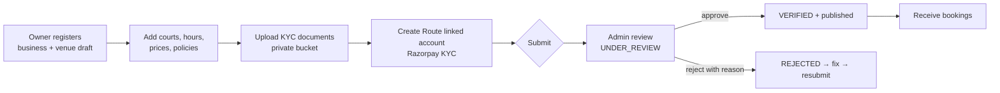

# 05 · Business Logic & Core Engines

| | |
|---|---|
| **Status** | v2.0 — pure domain modules (§2.2, §2.5, §4, §6) are **executable and unit-tested** (16 tests, source in [`_verification/domain/`](./_verification/README.md)); service-layer code (§2.1, §2.4, §3) is **reference implementation**, not yet run against a database |
| **Audience** | Backend engineers, QA, finance/ops reviewers |
| **Related** | [03-data-model](./03-data-model.md) · [04-api-specification](./04-api-specification.md) · [08-engineering-operations](./08-engineering-operations.md) |

**How to read the code in this document.** Blocks marked `packages/domain/*` are copied verbatim from tested files and may be adopted as-is. Blocks marked `packages/api/services/*` show the intended algorithm and error handling; treat them as a specification to implement and test (T-01…T-12 in 08), not as finished code.

---

## 1. Rules that must never be broken

| # | Rule | Where enforced |
|---|---|---|
| R1 | Two live bookings never overlap on a court. | DB exclusion constraint (03 §5.1) |
| R2 | A booking is confirmed **only** by a verified provider payment, through one idempotent function. | `confirmPayment()` §2.4 |
| R3 | Money is integer paise, calculated in one module, snapshotted on the booking. | `packages/domain/fees.ts` |
| R4 | Game and booking lifecycles are independent. | Separate tables and state machines |
| R5 | Every confirmed paid booking has exactly one successful payment and one venue transfer. | Partial unique index + nightly integrity queries |
| R6 | A player who pays for a slot that can no longer be given is refunded in full automatically. | §2.4 outcomes |
| R7 | Game capacity is never exceeded, including under concurrent joins. | Atomic SQL + CHECK |
| R8 | Anything that restricts a user (suspension, score-based limits) is reviewable, disputable and audited. | 07 §3.5, §6 below |

## 2. Court booking engine

### 2.1 Reservation (`initiateHold`)

Inputs: `userId`, `courtId`, `startTime`, `endTime`, `idempotencyKey`.

| Step | Action | Failure → |
|---|---|---|
| 1 | **Idempotent replay.** If a booking with this `idempotencyKey` exists for this user, return it unchanged. | – |
| 2 | **Validate request.** Interval lies within one IST day; aligned to the court's slot grid; duration within `minDurationMinutes…maxDurationMinutes`; start within `advanceBookingDays`; court and venue active and `VERIFIED`; user not suspended. | `BAD_REQUEST` |
| 3 | **Soft hold (optional fast path).** `SET hold:{court}:{startUnix}:{endUnix} {userId} NX EX 300`. If held by another user → `CONFLICT`. If Redis errors, **continue**; the database is the authority. | `CONFLICT` |
| 4 | **Open transaction**, then **take the court lock**: `pg_advisory_xact_lock(hashtextextended(courtId, 0))`. | – |
| 5 | **Lazily expire stale holds** overlapping the range (`PENDING` with `holdExpiresAt ≤ now()` → `EXPIRED`). This is what makes a lapsed hold instantly re-bookable without waiting for the job. | – |
| 6 | **Check blocks and opening hours** (`CourtBlock`, `CourtSchedule`). Venue "block slot" actions take the **same lock**. | `CONFLICT` (blocked) / `BAD_REQUEST` (closed) |
| 7 | **Price the interval** with `computeDaySlots` + `priceInterval` and `calculateFees` using the current `PlatformConfig`. | `CONFLICT` if any slot is not `AVAILABLE` |
| 8 | **Insert** the `PENDING` booking with `holdExpiresAt = now()+5 min`, the price snapshot and `pricingConfigVersion`. A violation of `bookings_no_overlap` (SQLSTATE `23P01`) maps to `CONFLICT`. | `CONFLICT` |
| 9 | **Write outbox rows** (`booking.expire` at `holdExpiresAt`). Commit. | – |
| 10 | After commit: dispatch outbox; return `{bookingId, holdExpiresAt, breakdown}`. | – |

**Lock-ordering rule (prevents deadlocks).** Any code path that needs more than one of these must acquire them in this order and no other: **court advisory lock → payment row → booking row → game row**. `confirmPayment()` therefore reads `booking.courtId` (immutable) *before* locking anything else.

```ts
// packages/api/src/services/booking/initiate-hold.ts  — reference implementation
export async function initiateHold(input: InitiateHoldInput, deps: Deps) {
  const { db, redis, now = () => new Date() } = deps;

  const replay = await db.booking.findUnique({ where: { idempotencyKey: input.idempotencyKey } });
  if (replay) {
    if (replay.userId !== input.userId) throw new DomainError('FORBIDDEN');
    return toHoldResponse(replay);
  }

  const court = await loadBookableCourt(db, input.courtId);          // active court + VERIFIED venue
  assertRequestShape(court, input, now());                           // grid, duration, horizon, single IST day
  const cfg = await loadPricingConfig(db);                           // PlatformConfig 'pricing'

  const soft = await trySoftHold(redis, input);                      // returns 'ok' | 'held-by-other' | 'unavailable'
  if (soft === 'held-by-other') throw new DomainError('SLOT_HELD');

  try {
    return await db.$transaction(
      async (tx) => {
        await tx.$executeRaw`SELECT pg_advisory_xact_lock(hashtextextended(${input.courtId}, 0))`;

        await tx.$executeRaw`
          UPDATE "bookings" SET "status" = 'EXPIRED', "updatedAt" = now()
          WHERE "courtId" = ${input.courtId} AND "status" = 'PENDING' AND "holdExpiresAt" <= now()
            AND tstzrange("startTime","endTime",'[)') && tstzrange(${input.startTime}::timestamptz, ${input.endTime}::timestamptz,'[)')`;

        const day = await loadDayInputs(tx, court, input.startTime, now()); // schedule, rules, blocks, LIVE bookings
        const slots = computeDaySlots(day);
        const basePaise = priceInterval(slots, input.startTime, input.endTime);  // throws if any slot not AVAILABLE
        const fees = calculateFees(basePaise, cfg.value);

        const booking = await tx.booking.create({
          data: {
            userId: input.userId, courtId: input.courtId,
            startTime: input.startTime, endTime: input.endTime,
            status: 'PENDING', holdExpiresAt: new Date(now().getTime() + 5 * 60_000),
            idempotencyKey: input.idempotencyKey,
            baseAmountPaise: fees.basePaise, convenienceFeePaise: fees.convenienceFeePaise,
            gstOnConvenienceFeePaise: fees.gstOnConvenienceFeePaise, discountPaise: fees.discountPaise,
            totalAmountPaise: fees.totalPaise, commissionPaise: fees.commissionPaise,
            gstOnCommissionPaise: fees.gstOnCommissionPaise, venuePayoutPaise: fees.venuePayoutPaise,
            pricingConfigVersion: cfg.version,
          },
        });
        await enqueue(tx, 'booking.expire', { bookingId: booking.id }, { runAt: booking.holdExpiresAt!, dedupeKey: `expire:${booking.id}` });
        return booking;
      },
      { maxWait: 5_000, timeout: 10_000 },
    ).then(toHoldResponse);
  } catch (e) {
    await releaseSoftHold(redis, input);                              // best effort
    if (isExclusionViolation(e)) throw new DomainError('SLOT_UNAVAILABLE');
    throw e;
  }
}

// 23P01 = exclusion_violation. Prisma surfaces the constraint name in the message.
const isExclusionViolation = (e: unknown) =>
  /bookings_no_overlap|23P01/.test(String((e as Error)?.message ?? '') + String((e as any)?.meta?.code ?? ''));
```

What changed from v1 and why:

- v1's lock key was a hand-rolled `BigInt` hash that was not truncated to 64 bits and would overflow Postgres' `bigint`; it also hashed `(court, start)`, so two *overlapping but not identical* slots took different locks. v2 locks the **court**.
- v1's overlap check ignored `PENDING` holds and `IN_PROGRESS` bookings, and its amounts (`49200`, a hard-coded ₹400 court) were literals.
- v1 never created an expiry job in the code path, so `PENDING` rows would live forever.

### 2.2 Pricing and fee model

v1 contained three incompatible models (a 18 %-of-court "tax" in the schema doc, GST on the platform fee only in the engine doc, hard-coded literals in the booking code). **This section is now the single definition.** All numbers are *hypotheses* held in `PlatformConfig` (`key = "pricing"`) and tuned after willingness-to-pay testing (product plan §4.8).

| Component | Definition | Default | Who bears it |
|---|---|---|---|
| Base court price | Venue's quoted price for the interval (price bands from `PricingRule`) | e.g. ₹400/h | Player pays; venue receives it minus commission |
| Convenience fee | Flat fee charged to the player | ₹20 | Player |
| GST on convenience fee | `gstBps` (18 %) × fee | ₹3.60 | Player (platform remits) |
| Commission | `commissionBps` (10 %) × base price | ₹40 | Venue (withheld from payout) |
| GST on commission | `gstBps` × commission, platform invoices the venue | ₹7.20 | Venue (withheld from payout) |
| Venue payout | base − commission − GST on commission | ₹352.80 | Venue receives |
| Court GST | The venue's responsibility if registered. The quoted price is the final price to the player (inclusive of any GST) | – | Venue |

> **Finance review required (open item F-02).** GST treatment of the convenience fee and commission, whether Playlo acts as an e-commerce operator liable to collect tax at source on supplies it facilitates, invoicing format, and the Razorpay fee burden must be confirmed by a chartered accountant before launch. The code is parameterised so the answer changes configuration, not structure.

```ts
// packages/domain/src/fees.ts

export interface PricingConfig {
  convenienceFeePaise: number; // flat fee charged to the player, e.g. 2000 = ₹20
  gstBps: number;              // 1800 = 18 %
  commissionBps: number;       // 1000 = 10 % of the court price, taken from the venue
}

export interface FeeBreakdown {
  basePaise: number;                // court price set by the venue (what the venue quoted the player)
  convenienceFeePaise: number;
  gstOnConvenienceFeePaise: number;
  discountPaise: number;
  totalPaise: number;               // what the player pays
  commissionPaise: number;          // platform commission, withheld from the venue
  gstOnCommissionPaise: number;     // GST the platform charges the venue on that commission
  venuePayoutPaise: number;         // what the venue receives via Route
}

/** Round-half-up percentage in basis points, integer arithmetic only. */
export function applyBps(amountPaise: number, bps: number): number {
  if (!Number.isInteger(amountPaise) || amountPaise < 0) throw new RangeError('amountPaise must be a non-negative integer');
  return Math.floor((amountPaise * bps + 5000) / 10000);
}

export function calculateFees(basePaise: number, cfg: PricingConfig, discountPaise = 0): FeeBreakdown {
  if (!Number.isInteger(basePaise) || basePaise <= 0) throw new RangeError('basePaise must be a positive integer');
  if (!Number.isInteger(discountPaise) || discountPaise < 0 || discountPaise > basePaise) throw new RangeError('invalid discount');

  const convenienceFeePaise = cfg.convenienceFeePaise;
  const gstOnConvenienceFeePaise = applyBps(convenienceFeePaise, cfg.gstBps);
  const totalPaise = basePaise + convenienceFeePaise + gstOnConvenienceFeePaise - discountPaise;

  const commissionPaise = applyBps(basePaise, cfg.commissionBps);
  const gstOnCommissionPaise = applyBps(commissionPaise, cfg.gstBps);
  const venuePayoutPaise = basePaise - commissionPaise - gstOnCommissionPaise;

  return {
    basePaise, convenienceFeePaise, gstOnConvenienceFeePaise, discountPaise, totalPaise,
    commissionPaise, gstOnCommissionPaise, venuePayoutPaise,
  };
}

/** Phase-1 defaults. These are HYPOTHESES to validate (product plan §4.8), stored in PlatformConfig, never hard-coded at call sites. */
export const DEFAULT_PRICING: PricingConfig = { convenienceFeePaise: 2000, gstBps: 1800, commissionBps: 1000 };

export const formatINR = (paise: number) =>
  new Intl.NumberFormat('en-IN', { style: 'currency', currency: 'INR', minimumFractionDigits: paise % 100 === 0 ? 0 : 2 }).format(paise / 100);
```

**Worked example (₹400 court, default config):** player pays **₹423.60** = 400.00 + 20.00 + 3.60. Venue receives **₹352.80** = 400.00 − 40.00 − 7.20. Platform holds 20.00 + 40.00 as revenue and owes the tax authority 3.60 + 7.20 = 10.80. This matches the v1 Playwright expectation (`₹423.60`), which was correct even though v1's schema doc contradicted it.

**Rounding:** half-up, per line item, integer arithmetic (`applyBps`). Totals are sums of rounded items. A test asserts the two accounting identities (`total = base + fee + gst − discount`, `payout = base − commission − gst`) for every ₹1 from ₹1 to ₹2 000 (see `domain.test.ts`), and the database re-checks them with CHECK constraints.

**Discounts** (Phase 2 promotions) reduce what the player pays and are **platform-funded** by default; the payout identity above deliberately ignores them. A venue-funded promotion needs a new column and a changed identity — do not reuse `discountPaise` for it.

### 2.3 Unit economics (illustrative)

Per ₹400 booking, default config, *assuming* a 2 % + 18 % GST gateway fee on the amount collected and no Route fee. These are placeholders to be replaced with the real Razorpay contract.

| Line | Amount |
|---|---|
| Platform revenue (fee + commission, ex-GST) | ₹60.00 |
| Gateway fee on ₹423.60 at 2 % | −₹8.47 |
| GST on gateway fee (if input credit is not available) | −₹1.52 |
| **Contribution before support, Route fees and incentives** | **≈ ₹50.00** |

Sensitivities that matter more than infrastructure cost: (a) whether UPI pricing is lower than 2 %, (b) refunds — gateway fees are generally not returned, so every refunded booking costs the full gateway fee, (c) support time per booking, (d) Route per-transfer charges (confirm), (e) venue churn. Track `contributionPerBooking` as defined in product plan §7.9 from day one (08 §Metrics).

### 2.4 Payment confirmation (`confirmPayment`)

One function, three callers: the **webhook** (authoritative), the **client verify** call (fast path, after checking the Checkout signature), and the **reconciliation job**. Calling it in any order, any number of times, must converge to the same state.

```text
confirmPayment({ razorpayOrderId, razorpayPaymentId, amountPaise, currency, method, source })

 0. Read booking.courtId for this order (no lock).
 1. BEGIN. Take the court advisory lock.                        ← lock order rule (§2.1)
 2. SELECT … FROM payments WHERE razorpayOrderId = $1 FOR UPDATE.
      none found           → record anomaly + alert; return UNKNOWN_ORDER (webhook still replies 200).
      already SUCCEEDED+   → return ALREADY_CONFIRMED.           (idempotent replay)
 3. Verify amount === payment.amountPaise AND currency === 'INR'.
      mismatch             → payment.failureCode = AMOUNT_MISMATCH; alert (page); create full refund; return AMOUNT_MISMATCH.
 4. SELECT … FROM bookings WHERE id = payment.bookingId FOR UPDATE.
 5. Payment → SUCCEEDED (capturedAt, method, razorpayPaymentId).
 6. Branch on booking.status:
      PENDING | PAYMENT_PENDING → CONFIRMED (confirmedAt).   Create Transfer(PENDING, venuePayoutPaise).
      EXPIRED   → if no live overlap now: → CONFIRMED + audit LATE_PAYMENT_REVIVED
                  else → REFUND_PENDING + Refund(100 %, tier SLOT_UNAVAILABLE).
      CANCELLED → REFUND_PENDING + Refund(100 %, tier SLOT_UNAVAILABLE)   (player abandoned, then paid)
      CONFIRMED | COMPLETED (different payment id) → Refund this payment 100 % (duplicate charge).
 7. Write outbox: notifications, razorpay.transfer.create (if confirmed), razorpay.refund.create (if refund).
 8. COMMIT.
```

Why this matters: v1's webhook updated `CONFIRMED` unconditionally. A payment that arrived *after* the 5-minute hold had expired and the slot had been sold to someone else would have flipped a cancelled booking back to `CONFIRMED` and double-booked the court. Under v2 the exclusion constraint makes that impossible and the player is refunded automatically.

```ts
// apps/web/app/api/webhooks/razorpay/route.ts — reference implementation
import crypto from 'node:crypto';

export async function POST(req: Request) {
  const raw = await req.text();                                   // MUST be the raw body, not re-serialised JSON
  const sig = req.headers.get('x-razorpay-signature') ?? '';
  const eventId = req.headers.get('x-razorpay-event-id');         // provider's unique event id
  const expected = crypto.createHmac('sha256', env.RAZORPAY_WEBHOOK_SECRET).update(raw).digest('hex');

  const ok = sig.length === expected.length &&
             crypto.timingSafeEqual(Buffer.from(sig), Buffer.from(expected));   // constant-time compare
  if (!ok || !eventId) return new Response('invalid', { status: 400 });

  const event = JSON.parse(raw);

  // Inbox: insert-or-ignore on (provider,eventId). A duplicate delivery returns 200 immediately.
  const inserted = await db.webhookEvent.createMany({
    data: [{ provider: 'razorpay', eventId, type: event.event, payload: event }],
    skipDuplicates: true,
  });
  if (inserted.count === 0) return new Response('duplicate', { status: 200 });

  try {
    await handleRazorpayEvent(event);                             // switch on event.event (below)
    await db.webhookEvent.update({ where: { provider_eventId: { provider: 'razorpay', eventId } },
                                   data: { status: 'PROCESSED', processedAt: new Date() } });
    return new Response('ok', { status: 200 });
  } catch (err) {
    await db.webhookEvent.update({ where: { provider_eventId: { provider: 'razorpay', eventId } },
                                   data: { status: 'FAILED', error: String(err), attempts: { increment: 1 } } });
    return new Response('retry', { status: 500 });                // Razorpay retries with backoff
  }
}
```

Handled events: `payment.captured` / `order.paid` → `confirmPayment`; `payment.failed` → record failure (booking stays `PAYMENT_PENDING` so the player can retry on the same order until the hold lapses); `refund.processed` / `refund.failed` → update `Refund` and booking; `transfer.processed` / `transfer.settled` / `transfer.failed` → update `Transfer`. **Unknown events are stored with `IGNORED` and acknowledged**, never errored.

Notes: (a) The failed-event row makes the retry visible in the admin console; a `FAILED` older than 30 minutes alerts. (b) Return 200 for duplicates and unknown orders; return 5xx only for transient failures. (c) Do **not** reference webhook payload amounts as trusted without step 3.

**Client verify path.** `payment.verify({orderId, paymentId, signature})` recomputes `HMAC_SHA256(orderId + "|" + paymentId, RAZORPAY_KEY_SECRET)` with a timing-safe compare; if valid it fetches the payment from Razorpay's API (never trusts the browser's claim of amount) and calls `confirmPayment(source:'client')`. It exists so the player sees "Confirmed" in 1–2 seconds instead of waiting for the webhook; it adds no authority.

### 2.5 Cancellation and refunds

The default matrix (product-plan parity with v1). A venue may supply a stricter or looser `cancellationPolicy` inside platform-set bounds (open item P-04).

| Time before start | Player refund (of base price) | Convenience fee + GST | Venue keeps |
|---|---|---|---|
| ≥ 24 h | 100 % | Not refunded | Nothing (full reversal) |
| 12 h to < 24 h | 50 % | Not refunded | 50 % of base, less commission and GST on it |
| < 12 h or after start | 0 % | Not refunded | 100 % of base, less commission and GST on it |
| Cancelled by venue / admin / system, or slot unavailable | **100 % of everything paid** | **Refunded** | Nothing; venue reliability is flagged |

Boundaries are exact: precisely 24 h before start is in the 100 % tier, precisely 12 h in the 50 % tier (tested). Commission is **recomputed on the retained amount**, so the venue is not charged commission on money it never keeps.

```ts
// packages/domain/src/refunds.ts

export interface RefundTierRule {
  minHoursBefore: number; // tier applies when hours-until-start >= this value
  refundBps: number;      // share of the BASE court price refunded (10000 = 100 %)
  code: string;
}

/** Platform default; a venue may override via Venue.cancellationPolicy (must stay within platform bounds). */
export const DEFAULT_REFUND_TIERS: RefundTierRule[] = [
  { minHoursBefore: 24, refundBps: 10000, code: 'GT_24H' },
  { minHoursBefore: 12, refundBps: 5000, code: 'H12_24' },
  { minHoursBefore: 0, refundBps: 0, code: 'LT_12H' },
];

export type CancelledBy = 'USER' | 'VENUE' | 'ADMIN' | 'SYSTEM';

export interface RefundInput {
  cancelledBy: CancelledBy;
  /** Set when the player pays but the slot can no longer be given (late payment after expiry, etc.). */
  slotUnavailable?: boolean;
  startTime: Date;
  now: Date;
  basePaise: number;
  convenienceFeePaise: number;
  gstOnConvenienceFeePaise: number;
  totalPaise: number;
  venuePayoutPaise: number;
  commissionBps: number;
  gstBps: number;
  tiers?: RefundTierRule[];
}

export interface RefundDecision {
  tier: string;
  refundPaise: number;         // amount returned to the player
  venueKeepsPayoutPaise: number; // venue payout that remains after the cancellation
  transferReversalPaise: number; // amount to claw back from the Route transfer
  nonRefundableFeePaise: number; // convenience fee + GST retained by the platform
}

const bps = (amount: number, rate: number) => Math.floor((amount * rate + 5000) / 10000);

export function computeRefund(i: RefundInput): RefundDecision {
  // Anything that is not the player's choice returns everything, including the convenience fee.
  if (i.cancelledBy !== 'USER' || i.slotUnavailable) {
    return {
      tier: i.slotUnavailable ? 'SLOT_UNAVAILABLE' : 'VENUE_CANCELLED',
      refundPaise: i.totalPaise,
      venueKeepsPayoutPaise: 0,
      transferReversalPaise: i.venuePayoutPaise,
      nonRefundableFeePaise: 0,
    };
  }

  const hoursBefore = (i.startTime.getTime() - i.now.getTime()) / 3_600_000;
  const tiers = [...(i.tiers ?? DEFAULT_REFUND_TIERS)].sort((a, b) => b.minHoursBefore - a.minHoursBefore);
  const tier = hoursBefore < 0
    ? { minHoursBefore: -Infinity, refundBps: 0, code: 'AFTER_START' }
    : tiers.find((t) => hoursBefore >= t.minHoursBefore) ?? tiers[tiers.length - 1]!;

  const refundedBase = bps(i.basePaise, tier.refundBps);
  const retainedBase = i.basePaise - refundedBase;
  const commission = bps(retainedBase, i.commissionBps);
  const venueKeeps = retainedBase - commission - bps(commission, i.gstBps);

  return {
    tier: tier.code,
    refundPaise: refundedBase, // convenience fee + its GST are never returned on a player cancellation
    venueKeepsPayoutPaise: venueKeeps,
    transferReversalPaise: i.venuePayoutPaise - venueKeeps,
    nonRefundableFeePaise: i.convenienceFeePaise + i.gstOnConvenienceFeePaise,
  };
}
```

Worked example, 18 h before start, ₹400 booking: refund ₹200.00; venue keeps ₹176.40 (200 − 20 commission − 3.60 GST); transfer reversal ₹176.40; platform retains ₹47.20 = fee 20 + GST 3.60 + commission 20 + GST 3.60 (tested to balance to the paisa).

**Execution:** `booking.cancel` computes the decision with `computeRefund`, then in one transaction: sets booking `CANCELLED` (refund = 0) or `REFUND_PENDING`, creates the `Refund` (idempotency key `refund:{bookingId}`), and writes outbox jobs for `razorpay.transfer.reverse` (if the transfer was processed) and `razorpay.refund.create`. `refund.processed` completes the booking to `REFUNDED`. Provider calls happen in jobs, never inside the transaction.

Edge rules: a refund may never push `Σ refunds > payment.amountPaise` (checked under `FOR UPDATE` on the payment); partial refunds set the payment to `PARTIALLY_REFUNDED`; a failed refund leaves the booking in `REFUND_PENDING` and raises an alert (runbook R6).

### 2.6 Settlement with Razorpay Route

1. Venue onboarding creates a Route **linked account** (`VenueLinkedAccount`); the venue completes KYC with Razorpay. Playlo never holds bank details. A venue cannot be published until `kycStatus = ACTIVATED`.
2. `payment.createOrder` creates the order for `totalAmountPaise` and attaches `transfers: [{ account, amount: venuePayoutPaise, currency: 'INR', on_hold: … }]` (exact parameter names to be confirmed against the Route API reference in Sprint 0).
3. Playlo's share (fee + commission + GST on both) stays in the platform balance.
4. On refund, the transfer is **reversed** for `transferReversalPaise` before or with the refund so the platform is not out of pocket.
5. Settlement timing (T+n), settlement-on-hold options and per-transfer fees are commercial terms to confirm with Razorpay (open item F-03). If Route is not approved in time, the fallback for launch is **platform-collects, manual weekly payout** with the same data model (`Transfer` rows created and marked settled by finance).

### 2.7 Expiry and reconciliation jobs

| Job | Logic |
|---|---|
| `booking.expire` (at `holdExpiresAt`) | Skip if `CONFIRMED`/`COMPLETED`. If `PAYMENT_PENDING`: fetch the order from Razorpay; if paid → `confirmPayment(source:'reconcile')`; if attempts exist and not failed → extend once by 10 min; else → `EXPIRED`. If `PENDING` → `EXPIRED`. Delete the Redis soft hold. |
| `payment.reconcile` (T+10 min, then hourly for 24 h) | For payments `INITIATED` older than 10 min: fetch order/payments from Razorpay and converge. After 24 h with no payment, mark `FAILED`. |
| `booking.complete` (sweeper every 15 min) | `CONFIRMED` bookings with `endTime < now()` → `COMPLETED`. |
| Nightly | Run the integrity queries in 03 §7.3; page on any row. Compare Razorpay settlement report totals with `Transfer` rows. |

## 3. Game engine

Games are playing sessions organised by players. They do **not** require a booking (public park, private court). Capacity is a hard invariant.

### 3.1 Join rules

A user may join iff **all** hold. Each failure has a distinct error code so the UI can explain it.

| Check | Error |
|---|---|
| Account active, 18+ confirmed, not blocked by the host (and vice versa) | `FORBIDDEN` |
| Game status ∈ {OPEN, CONFIRMED}, `now < startTime` | `GAME_NOT_JOINABLE` |
| Visibility: `PUBLIC`; or invited (`PRIVATE_INVITE`); or member of the community (`COMMUNITY_ONLY`) | `NOT_ELIGIBLE` |
| User's declared skill within `[minSkillLevel, maxSkillLevel]` (soft: warn, allow request when `joinPolicy = APPROVAL`) | `SKILL_MISMATCH` |
| Not the host; not already `CONFIRMED` | `ALREADY_JOINED` |
| Phase 2, when enabled: reliability tier not `AT_RISK` for *competitive* games — a **soft gate with an explanation and a request-to-host override**, not a hard block (principle R8) | `NEEDS_HOST_APPROVAL` |
| Seat available → `CONFIRMED`; otherwise → `WAITLISTED` | – |
| `joinPolicy = APPROVAL` → `REQUESTED` (host decides) | – |

### 3.2 Atomic join (reference implementation)

v1's join read participants, counted in memory, then wrote `confirmedCount = currentConfirmed + 1`. Its comment said "lock game row" but no lock was taken, so two simultaneous joiners at 3/4 could both succeed. It also never inserted the host as a participant while `confirmedCount` defaulted to 1, so the in-memory count and the stored counter disagreed by one from the start. v2 fixes both: the host row is created with the game, and the seat is claimed by a **single conditional UPDATE**.

```ts
// packages/api/src/services/game/join.ts — reference implementation
export async function joinGame({ gameId, userId }: { gameId: string; userId: string }, { db }: Deps) {
  const game = await db.game.findUniqueOrThrow({ where: { id: gameId } });
  assertJoinable(game, await loadUserContext(db, userId, game));   // §3.1 checks (pure + a few reads)

  if (game.joinPolicy === 'APPROVAL') return requestToJoin(db, game, userId);

  try {
    return await db.$transaction(async (tx) => {
      // 1. Claim a seat. One statement, atomic, cannot exceed capacity.
      const claimed = await tx.$executeRaw`
        UPDATE "games"
        SET "confirmedCount" = "confirmedCount" + 1,
            "status" = CASE WHEN "status" = 'OPEN' AND "confirmedCount" + 1 >= "maxParticipants"
                            THEN 'FULL'::"GameStatus" ELSE "status" END,
            "updatedAt" = now()
        WHERE "id" = ${gameId} AND "status" IN ('OPEN','CONFIRMED') AND "confirmedCount" < "maxParticipants"`;
      if (claimed === 0) throw new DomainError('GAME_FULL');       // → caller offers waitlist

      // 2. Insert or re-activate the participant. The unique (gameId,userId) arbitrates duplicates.
      const rows = await tx.$queryRaw<{ id: string }[]>`
        INSERT INTO "game_participants" ("id","gameId","userId","status","joinedAt","updatedAt")
        VALUES (${newId()}, ${gameId}, ${userId}, 'CONFIRMED', now(), now())
        ON CONFLICT ("gameId","userId") DO UPDATE
          SET "status" = 'CONFIRMED', "leftAt" = NULL, "joinedAt" = now(), "updatedAt" = now()
          WHERE "game_participants"."status" <> 'CONFIRMED'
        RETURNING "id"`;
      if (rows.length === 0) throw new DomainError('ALREADY_JOINED'); // rolls back step 1

      await enqueue(tx, 'notification.deliver', { type: 'GAME_JOINED', gameId, userId }, { dedupeKey: `joined:${gameId}:${userId}:${Date.now()}` });
      return { status: 'CONFIRMED' as const };
    });
  } catch (e) {
    if (e instanceof DomainError && e.code === 'GAME_FULL') return joinWaitlist(db, gameId, userId);
    throw e;
  }
}
```

Leaving mirrors this: conditional `UPDATE … SET status='LEFT', leftAt=now() WHERE status='CONFIRMED' RETURNING`, then `confirmedCount − 1` (never below 1; the host cannot leave — they cancel or transfer hosting), `FULL → OPEN`, then promote the oldest `WAITLISTED` participant through the same claim step. `leftAt` against `startTime` later classifies a **late cancellation** (< 4 h) for reliability (§6).

### 3.3 Host actions and completion

- **Approve / decline requests**, **remove participant** (reason recorded), **edit** (time/venue changes notify everyone and re-open acknowledgment), **confirm** (guard `confirmedCount ≥ minParticipants`), **cancel** (reason required; notifies; does *not* touch a linked booking — the host is asked what to do with it).
- **Complete:** host marks complete after `startTime`, or the sweeper completes at `endTime + 3 h`. Completion creates `Attendance(PENDING)` for each confirmed participant and sends feedback prompts.
- **Attendance:** host marks `ATTENDED`/`NO_SHOW`/`EXCUSED` within 48 h; unmarked rows default to `ATTENDED` after 72 h only if no participant disputes (rationale: avoid punishing players because a host forgot). Participants can dispute a `NO_SHOW` for moderator review (Phase 2).

## 4. Venue availability engine

Pure computation over rules and bookings; the service loads inputs (one indexed read per table per court-day) and calls the domain function. India has no daylight saving, so a constant `+05:30` offset is correct and is isolated in this one module.

```ts
// packages/domain/src/availability.ts
// India observes no DST, so a fixed +05:30 offset is correct for Asia/Kolkata. All IST handling lives here.

export const IST_OFFSET_MIN = 330;
const MS_MIN = 60_000;

export interface CourtConfig { slotMinutes: number; baseHourlyRatePaise: number; }
export interface ScheduleWindow { dayOfWeek: number; openMinute: number; closeMinute: number; } // ISO 1..7
export interface PriceRule {
  daysOfWeek: number[]; startMinute: number; endMinute: number; hourlyRatePaise: number; priority: number;
  validFrom?: string | null; validTo?: string | null; // 'YYYY-MM-DD' inclusive
}
export interface Interval { startTime: Date; endTime: Date; }

export type SlotState = 'AVAILABLE' | 'BOOKED' | 'BLOCKED' | 'CLOSED' | 'PAST' | 'TOO_FAR';
export interface Slot { startTime: Date; endTime: Date; pricePaise: number; state: SlotState; }

/** Local midnight of 'YYYY-MM-DD' (IST) as a UTC instant. */
export function istDayStart(dateStr: string): Date {
  const m = /^(\d{4})-(\d{2})-(\d{2})$/.exec(dateStr);
  if (!m) throw new RangeError('date must be YYYY-MM-DD');
  const [y, mo, d] = [Number(m[1]), Number(m[2]), Number(m[3])];
  const utc = Date.UTC(y, mo - 1, d, 0, 0, 0, 0);
  if (new Date(utc).getUTCDate() !== d) throw new RangeError('invalid calendar date');
  return new Date(utc - IST_OFFSET_MIN * MS_MIN);
}

export function isoWeekday(dateStr: string): number {
  const [y, m, d] = dateStr.split('-').map(Number) as [number, number, number];
  const js = new Date(Date.UTC(y, m - 1, d)).getUTCDay(); // 0 = Sunday
  return js === 0 ? 7 : js;
}

const overlaps = (a: Interval, b: Interval) => a.startTime < b.endTime && b.startTime < a.endTime; // half-open

export function slotPricePaise(court: CourtConfig, rules: PriceRule[], dateStr: string, startMinute: number): number {
  const dow = isoWeekday(dateStr);
  const match = rules
    .filter((r) =>
      r.daysOfWeek.includes(dow) && r.startMinute <= startMinute && startMinute < r.endMinute &&
      (!r.validFrom || dateStr >= r.validFrom) && (!r.validTo || dateStr <= r.validTo))
    .sort((a, b) => b.priority - a.priority)[0];
  const hourly = match ? match.hourlyRatePaise : court.baseHourlyRatePaise;
  return Math.round((hourly * court.slotMinutes) / 60);
}

export interface DayInput {
  dateStr: string;
  court: CourtConfig;
  schedule: ScheduleWindow[];
  rules: PriceRule[];
  blocks: Interval[];
  liveBookings: Interval[]; // already filtered by the "live" definition in docs/03 §3.1
  now: Date;
  advanceBookingDays: number;
}

export function computeDaySlots(i: DayInput): Slot[] {
  const dow = isoWeekday(i.dateStr);
  const dayStart = istDayStart(i.dateStr).getTime();
  const horizon = i.now.getTime() + i.advanceBookingDays * 86_400_000;
  const slots: Slot[] = [];

  for (const w of i.schedule.filter((s) => s.dayOfWeek === dow).sort((a, b) => a.openMinute - b.openMinute)) {
    for (let m = w.openMinute; m + i.court.slotMinutes <= w.closeMinute; m += i.court.slotMinutes) {
      const startTime = new Date(dayStart + m * MS_MIN);
      const endTime = new Date(dayStart + (m + i.court.slotMinutes) * MS_MIN);
      const iv = { startTime, endTime };
      let state: SlotState = 'AVAILABLE';
      if (endTime <= i.now) state = 'PAST';
      else if (startTime.getTime() > horizon) state = 'TOO_FAR';
      else if (i.blocks.some((b) => overlaps(iv, b))) state = 'BLOCKED';
      else if (i.liveBookings.some((b) => overlaps(iv, b))) state = 'BOOKED';
      slots.push({ ...iv, pricePaise: slotPricePaise(i.court, i.rules, i.dateStr, m), state });
    }
  }
  return slots;
}

/** Price of a requested interval; throws if it is not an exact run of AVAILABLE slots. */
export function priceInterval(slots: Slot[], start: Date, end: Date): number {
  const covered = slots.filter((s) => s.startTime >= start && s.endTime <= end);
  const contiguous =
    covered.length > 0 &&
    covered[0]!.startTime.getTime() === start.getTime() &&
    covered[covered.length - 1]!.endTime.getTime() === end.getTime() &&
    covered.every((s, idx) => idx === 0 || covered[idx - 1]!.endTime.getTime() === s.startTime.getTime());
  if (!contiguous || covered.some((s) => s.state !== 'AVAILABLE')) throw new RangeError('interval not bookable');
  return covered.reduce((sum, s) => sum + s.pricePaise, 0);
}
```

Service wiring (`venue.getAvailability`): load court, schedule, price rules, blocks and **live** bookings for `[dayStart, dayEnd)`; call `computeDaySlots`; for each `AVAILABLE` slot, mask it if a Redis soft hold from another user exists (`MGET` all keys in **one** round trip — v1 issued 16 sequential `GET`s); return slots with `heldByMe` only for the caller. Cache the *rules* (schedule, rules) per court for 60 s; never cache bookings.

Venue-side edits (**block slot**, **change hours**, **change price**) take the court advisory lock; a block over an existing booking is rejected with the list of affected bookings — the venue must cancel those explicitly (which refunds the players in full as a venue cancellation).

## 5. Venue onboarding workflow



Publish gate (all required): documents approved, `kycStatus = ACTIVATED` (or manual-payout fallback flag), ≥ 1 active court with schedule and a price, cancellation policy accepted, photos ≥ 3, phone verified. Admin approval records reviewer, timestamp and reason in `AuditLog`.

**Pilot reality:** for the first 2–5 venues the founder can enter courts, hours and prices on the owner's behalf through the admin console and run KYC with the owner on a call. Building the full self-serve portal first is the single largest avoidable scope in v1's plan (see 09 §Scope options).

## 6. Player reliability

### 6.1 Phase 1 — descriptive only

Show facts, not a verdict: *games played*, *attended rate (last 20)*, *late cancellations (last 90 days)*, *hosted games*. Computed on read from `Attendance` and `GameParticipant`. No stored score, no automatic restriction. This follows the product plan ("begin with descriptive attendance history, then introduce a numeric score only when needed").

### 6.2 Phase 2 — score, with safeguards

v1's formula was `100 − 25·noShows − 10·lateCancels + 2·fulfilledGames`. Problems: it is **cumulative for life** (a no-show can be erased by 13 games and a few early mistakes can never age out), order-insensitive, unbounded before capping, penalises new players for tiny samples, and it auto-restricted players below 75 %, contradicting the product plan's rules (publish criteria, allow disputes, account for legitimate cancellations, never penalise on a single event). v2:

```ts
// packages/domain/src/reliability.ts

export interface ReliabilityInput {
  attended: number;    // in the rolling window
  noShows: number;     // unexcused
  lateCancels: number; // left < 4 h before start, unexcused
}

export type ReliabilityTier = 'NEW' | 'RELIABLE' | 'STANDARD' | 'AT_RISK';

export const RELIABILITY_WINDOW = 20; // most recent counted outcomes
export const MIN_SAMPLE_FOR_SCORE = 5;

/**
 * Smoothed attendance ratio with a mild prior (+2 attended). Properties:
 *  - bounded 0..100, no cap/floor hacks;
 *  - a no-show costs 3x a late cancel, but both age out of the window;
 *  - new players are never shown as "bad" (tier NEW until enough data).
 */
export function reliabilityScore(i: ReliabilityInput): { score: number; sampleSize: number; tier: ReliabilityTier } {
  const sampleSize = i.attended + i.noShows + i.lateCancels;
  const score = Math.round((100 * (i.attended + 2)) / (i.attended + 3 * i.noShows + i.lateCancels + 2));
  const tier: ReliabilityTier =
    sampleSize < MIN_SAMPLE_FOR_SCORE ? 'NEW' : score >= 90 ? 'RELIABLE' : score >= 75 ? 'STANDARD' : 'AT_RISK';
  return { score, sampleSize, tier };
}

/** Take the newest outcomes up to the window; excused outcomes must be filtered out BEFORE calling this. */
export function windowOutcomes(outcomes: Array<'ATTENDED' | 'NO_SHOW' | 'LATE_CANCEL'>): ReliabilityInput {
  const recent = outcomes.slice(0, RELIABILITY_WINDOW); // caller passes newest-first
  return {
    attended: recent.filter((o) => o === 'ATTENDED').length,
    noShows: recent.filter((o) => o === 'NO_SHOW').length,
    lateCancels: recent.filter((o) => o === 'LATE_CANCEL').length,
  };
}
```

| Attended (last ≤ 20) | No-shows | Late cancels | Score | Tier |
|---|---|---|---|---|
| 10 | 0 | 0 | 100 | Reliable |
| 18 | 0 | 2 | 91 | Reliable |
| 9 | 1 | 0 | 79 | Standard |
| 8 | 2 | 0 | 63 | At risk |
| 2 | 1 | 0 | – | **New** (sample < 5, no score shown) |

Rules: excused outcomes are excluded; a no-show counts three times a late cancel; only the 20 most recent counted outcomes matter so behaviour improves the score again; the score is a *signal for hosts and filters*, never an automatic ban — restrictions are moderator actions with a reason, a notification and an appeal path (07 §3.5). Display "Reliable / Standard / At risk" with the criteria linked ("How this works"). Persist a `ReliabilitySnapshot` nightly; show only to authenticated players in game lists, never publicly.

## 7. Player matching (Phase 2)

Rules before ML. Eligibility filters first (sport, within radius, skill within ±1 level, availability overlap > 0, not blocked, `discoverable`), then a transparent score:

```text
match = wSkill·skillFit + wDist·distanceFit + wAvail·availabilityOverlap + wFormat·formatMatch + wComm·sharedCommunities
        each factor normalised to [0,1]; weights start equal (0.2) and are tuned from join/accept rates.
```

`[SKILL_WEIGHT…COMMUNITY_WEIGHT]` from the product plan are therefore **parameters, not open decisions**; start equal and record changes in `PlatformConfig`. Never present the score as a compatibility promise; show reasons ("plays doubles, 1.2 km away, free on Saturday evenings").

## 8. Sharing and growth: WhatsApp

Game coordination in India happens in WhatsApp groups, so every game must have a link that previews well and works without logging in.

- **Public share page** `/g/{shareCode}` (server-rendered, **`noindex`**, Open Graph image generated with `next/og`): title, sport, date/time (IST), venue or custom location name, spots left, skill range, host first name, cost note. It shows **no** phone numbers, exact addresses of private locations, or participant names. A single "Join in the app" button deep-links to `/app/games/{id}` and, if logged out, to login with `returnTo`.
- v1 shared `https://playlo.in/app/games/{id}`, which sits behind login and `noindex`, so WhatsApp's link preview would show nothing useful and every first click would hit a login wall.
- Private (`PRIVATE_INVITE`/`COMMUNITY_ONLY`) games render a generic "invite-only game" card with no details until the viewer is eligible.
- Share text is built from i18n messages with proper ICU pluralisation (v1 hard-coded "Sirsa" and its own `s` suffix logic); links carry `?ref=wa_share&g={shareCode}` for attribution.

```ts
// packages/ui/src/lib/share.ts
export function whatsappShareUrl(text: string) {
  return `https://wa.me/?text=${encodeURIComponent(text)}`;
}
// Message built by t('share.gameInvite', { title, when, where, spotsLeft, url }) — one template per locale.
```

## 9. Notification matrix

Transactional only in Phase 1. Each SMS template needs **DLT registration** (07 §5); keep templates few and generic. Delivery is via outbox → provider with retries; in-app notification is always written.

| Event | Recipients | In-app | Push | SMS | Notes |
|---|---|---|---|---|---|
| OTP | User | – | – | ✓ | DLT template `OTP` |
| Game join request | Host | ✓ | ✓ | – | |
| Join accepted / declined | Player | ✓ | ✓ | – | |
| Player joined / left | Host | ✓ | ✓ | – | Coalesce within 5 min |
| Game confirmed / updated | Participants | ✓ | ✓ | ✓ if start < 24 h | Time/venue change = SMS |
| Game cancelled | Participants | ✓ | ✓ | ✓ | DLT `GAME_CANCELLED` |
| Reminder (T−2 h) | Confirmed participants | ✓ | ✓ | – | Immediate if created inside the window |
| Booking confirmed | Player, venue staff | ✓ | ✓ | ✓ (player) | DLT `BOOKING_CONFIRMED` |
| Payment failed / hold expiring (T−1 min) | Player | ✓ | ✓ | – | |
| Refund initiated / processed | Player | ✓ | ✓ | ✓ | DLT `REFUND` |
| Booking cancelled by venue | Player (+ host) | ✓ | ✓ | ✓ | |
| New booking / cancellation | Venue staff | ✓ | ✓ | – | |

Respect `notificationPrefs`; transactional safety messages (payment, cancellations, security) cannot be disabled. Add quiet hours (22:00–07:00 IST) for non-urgent pushes.
