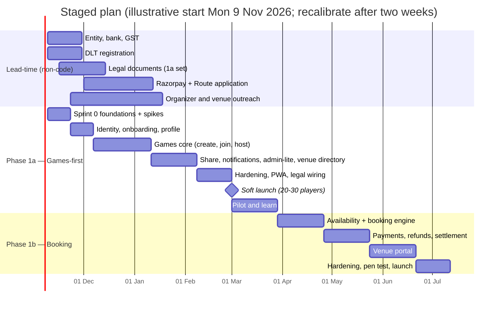

# 09 · Delivery Plan, Scope Options & Risks

| | |
|---|---|
| **Status** | v2.0 — replaces v1's 7-week sprint plan, which covered roughly a quarter of its own stated scope |
| **Audience** | Founder/owner, engineering lead, anyone estimating or funding the work |
| **Decision needed** | Choose a scope option (§3) — recorded as open item P-01 |
| **Estimate honesty** | Effort figures are **planning ranges from component counting**, not measurements. Recalibrate after two weeks of real velocity (§9). |
| **Related** | [01-product-requirements](./01-product-requirements.md) · [08-engineering-operations](./08-engineering-operations.md) · [12-open-items](./12-open-items.md) |

---

## 1. Why the v1 plan could not hold

v1 scheduled seven weeks for one developer to deliver: four applications, OTP auth, geo search, a booking engine with concurrency control, Razorpay Route split payments with webhooks, a PWA, a venue portal with calendar, an admin console with KYC queue, QStash reminders, tests, and legal documents — and *then* launch. Counting the components (§2) puts that scope at roughly **115–155 ideal developer-days**, i.e. **28–39 calendar weeks at ~4 productive days a week**. Seven weeks is about 25 % of that.

It also omitted work that is **not code and has lead time**: business registration and GST, Razorpay account and **Route approval**, **DLT registration for OTP SMS**, legal documents, venue agreements, and recruiting the first organizers and venues. Those items are on the critical path regardless of how fast code is written, and they are where launches in India typically slip.

## 2. Effort model (ideal developer-days, one full-stack engineer)

| # | Work package | Low | High | Notes |
|---|---|---:|---:|---|
| 1 | Foundations: monorepo, CI, DB + migrations (incl. integrity SQL), auth/OTP, flags, logging, tokens, base UI | 8 | 12 | Includes Sprint-0 spikes (§5) |
| 2 | Onboarding, profile, settings, consent, privacy | 5 | 7 | |
| 3 | Games: create, list/filter, detail, join/leave/waitlist, host tools, my-games, attendance | 14 | 18 | Atomic capacity logic + tests |
| 4 | Share page `/g/{code}`, OG image, WhatsApp flows | 2 | 3 | |
| 5 | Venue discovery, availability engine, price rules | 8 | 10 | Domain code already specified and tested |
| 6 | Booking and payments: hold, order, webhook, `confirmPayment`, expiry, reconcile, refunds, Route/fallback | 18 | 25 | Highest-risk package |
| 7 | Notifications: in-app, SMS (DLT), push, outbox, jobs | 8 | 10 | |
| 8 | Venue portal: register, KYC, courts/schedule/pricing, calendar, bookings | 15 | 20 | |
| 9 | Admin console: venue queue, users, bookings, payments, reports, config, audit | 10 | 14 | |
| 10 | Marketing site + legal pages | 6 | 8 | |
| 11 | i18n scaffolding + Hindi catalogs | 3 | 4 | |
| 12 | PWA + install + push | 3 | 4 | |
| 13 | Hardening: security pass, performance, accessibility, load test | 10 | 14 | |
| 14 | Launch operations: monitoring, runbooks, seed venues, support setup | 4 | 6 | |
| | **Total (full Phase 1)** | **114** | **155** | ≈ 28–39 weeks at 4 productive days/week |

Assumptions: one experienced full-stack engineer; AI coding assistance is *not* assumed (it may shorten implementation but not provider approvals, venue onboarding or testing time); founder/ops handles non-code workstreams in parallel; no multi-person coordination overhead.

## 3. Scope options

The product hypothesis is: *can we consistently help badminton players in one city find reliable people to play with, while giving venues a measurable reason to participate?* The first half needs **games**; the second half needs **bookings**. They have very different cost and risk, so v2 recommends a staged path.

| | **Option A — Games-first (recommended)** | **Option B — Full Phase 1 at once** | **Option C — Concierge** |
|---|---|---|---|
| What ships first | Player app: onboarding, create/join games, WhatsApp share page, my-games, attendance; venue **directory** (admin-entered, "call/WhatsApp to book", pay at venue); admin-lite; one landing page + legal | Everything in 01 Phase 1 incl. online booking, payments, venue portal | Same as A but even more manual (Google Form-style venue onboarding by founder, no PWA push) |
| Packages (§2) | 1, 2, 3, 4, 7-lite, 10-lite, 11, 12, 13, 14, parts of 5 and 9 | All | 1, 2, 3, 4, 7-lite, 10-lite, 14 |
| Effort | ≈ 60–80 dev-days → **~15–20 weeks** | 114–155 dev-days → **~28–39 weeks** | ≈ 40–50 dev-days → **~10–13 weeks** |
| Tests the hypothesis? | Player half fully; venue half via venue directory engagement and "booking intent" taps | Both halves | Player half, cheaply |
| Payments/regulatory exposure at launch | **None** (no money handled) | High: Route, GST/TDS, refunds, settlement | None |
| Main risk | Venues see less value until bookings arrive | Long time to learn anything; heavy fixed risk before first user | Quality ceiling; manual toil |
| What it defers | Booking engine (the riskiest component) | – | Everything beyond games |

**Recommendation:** start with **Option A**, then ship **Option B's** booking, payments and venue portal as **Phase 1b** once Phase 1a shows players are actually joining games (gate in §6). Rationale: it moves the highest-risk component (money + inventory) behind evidence of demand, shortens time to the first real user, and avoids carrying payment compliance before the product is proven. Everything built for 1a (identity, games, notifications, admin, i18n, share) is reused unchanged in 1b. The documentation set specifies both so engineering can work 1a without redesigning for 1b.

If the owner decides venue value must be demonstrated from day one (for example, because pilot venues will only engage if online booking exists), Option B remains valid — but the calendar must then be planned at roughly 7–9 months, not 7 weeks.

## 4. Critical-path workstreams that are **not** code (start in Week 0)

| Workstream | Owner | Typical lead time | Needed by | Fallback if late |
|---|---|---|---|---|
| Decide proprietorship vs company; PAN, bank account | Founder + CA | 1–3 weeks | Razorpay application (1b) | Personal/proprietorship path |
| GST registration (if required) + invoicing approach | CA | 1–3 weeks | 1b | Decide thresholds with CA |
| **DLT registration** (entity, sender header, OTP and transactional templates) | Founder / dev | ~1–3 weeks incl. template approvals | **Phase 1a launch** (OTP SMS) | Google sign-in as interim; or a provider offering WhatsApp OTP |
| Razorpay activation and **Route** application; per-venue linked-account KYC | Founder | Variable; approval not guaranteed | 1b | Platform-collects with manual weekly payouts (05 §2.6) |
| Legal documents: ToS, Privacy (DPDP-aligned), Refund, Cancellation, Community Guidelines, Cookie | Counsel | 2–4 weeks | 1a (ToS, Privacy, Guidelines), 1b (Refund, Cancellation) | Counsel-reviewed minimum set |
| Venue agreement template; pilot venue conversations | Founder | Ongoing | 1b (and for 1a directory) | – |
| Brand: trademark search, domain, logo, palette sign-off | Founder + designer | 1–2 weeks | Sprint 1 | Placeholder branding |
| Recruit 5 organizers and a first venue cluster in Sirsa | Founder | 4+ weeks | 1a soft launch | – |
| Grievance officer / support channels | Founder | 1 week | 1a | – |

## 5. Phased plan

### 5.1 Illustrative timeline

The calendar is illustrative: it shows ordering and dependency, not a commitment. Note that the **DPDP core obligations apply from about mid-May 2027** (07 §5, C4); the plan therefore builds consent, notices, retention and erasure into Phase 1a rather than retrofitting them.

### 5.2 Sprint 0 — Foundations and spikes (Weeks 1–2)

Deliver: monorepo, CI (04/08), Docker + Neon branching, schema and **both migrations applied** (03), seed, auth/OTP vertical slice behind the dev OTP, flags and logging skeleton, tokens and base components, README quick start.

**Spikes with explicit pass/fail (these protect the plan from unverified assumptions in these docs):**

| Spike | Question | Pass criterion |
|---|---|---|
| S1 — DB region | Is Singapore (Neon) latency acceptable from Sirsa? (ADR-003) | p95 availability endpoint ≤ 600 ms on 4G from Sirsa; otherwise evaluate a Mumbai-hosted Postgres |
| S2 — Constraint under concurrency | Does T-01 pass against Neon through the pooler? | 20 parallel holds → exactly 1 booking; no pooler errors |
| S3 — PostGIS query | Does the 03 §7.2 query run and perform on Neon? | Returns expected venues; EXPLAIN reviewed |
| S4 — Prisma drift | Does `prisma migrate dev` leave the hand-written constraints intact? | No proposed drops (03 §4.1) |
| S5 — Auth library | Phone-OTP session flow with Better Auth vs Auth.js v5 (ADR-004) | Working login, session revocation, role claims; choose and record |
| S6 — CSP | Does the nonce CSP work with Next, `next/font`, Razorpay (staging, Report-Only)? | No blocking violations on the checkout path |
| S7 — Razorpay Route | Confirm Route order/transfer/reversal parameters and sandbox behaviour (05 §2.6) | Sandbox order with transfer; reversal on refund |

### 5.3 Phase 1a milestones

| Milestone | Exit criterion |
|---|---|
| M1 Identity | Real OTP login via DLT template; onboarding complete; consent recorded |
| M2 Games | Create → publish → share → join → waitlist → host manage → complete → attendance; T-05 green |
| M3 Share and notifications | `/g/{code}` previews correctly in WhatsApp; SMS templates approved; reminders fire |
| M4 Admin-lite and directory | Admin can add venues; moderation queue works; audit logging verified |
| M5 Launch readiness | §7 checklist (1a column) all green; security pass T-09, T-10; accessibility pass |
| M6 Soft launch | 20–30 real players, 5 organizers, ≥ 2 venues in directory; daily metric review |

### 5.4 Phase 1b milestones

| Milestone | Exit criterion |
|---|---|
| M7 Availability + hold | Venue rules → correct grid; T-01 green on Neon; holds expire; nightly integrity query clean |
| M8 Payments | Test-mode end-to-end; T-02/03/04/06/08/12 green; refund tiers; reconciliation; Route (or manual-payout fallback) |
| M9 Venue portal | Venue self-onboards through KYC; sets hours/prices; blocks slots; sees bookings; T-09 for venue scope |
| M10 Paid pilot | 2 venues, real money, small cohort; daily reconciliation; SEV review |
| M11 Public launch | §7 checklist (1b column); external penetration test remediated |

## 6. Stage gates (metrics to proceed)

Gates stop the team from building Phase 1b, 2 or 3 on assumptions. **Numbers below are suggested defaults for the owner to confirm (open item P-02)**, not facts.

| Gate | Evidence required | Suggested thresholds |
|---|---|---|
| 1a → 1b | Players actually join games and come back | ≥ 30 % of eligible game viewers join; ≥ 60 % of joined players attend; ≥ 25 % of players join a second game within 14 days; ≥ 15 games/week created for 3 consecutive weeks |
| 1b → 2 | Bookings are paid and fulfilled; venues benefit | Paid, fulfilled bookings per active user ≥ target; ≥ 2 venues each with repeat bookings; refund + dispute rate < agreed ceiling; contribution per booking ≥ 0 |
| 2 → 3 | Retention and organizer behaviour | Week-4 retention and recurring-game metrics from 01 §6 |

## 7. Launch readiness checklist (go / no-go)

| Area | Item | 1a | 1b |
|---|---|:-:|:-:|
| Product | All launch-critical acceptance criteria in 01 §5 pass | ✓ | ✓ |
| Legal | ToS, Privacy (DPDP notice), Community Guidelines live; Refund/Cancellation policies live | ✓ | ✓ (refund/cancel) |
| Compliance | DLT templates approved; consent records working; erasure flow works; grievance contact published | ✓ | ✓ |
| Payments | Razorpay live, Route or manual-payout path, GST/TDS decisions made, webhook live endpoint tested with a real ₹1 payment and refund | – | ✓ |
| Security | T-09, T-10 (and T-03/04/06 for 1b) pass; CSP enforced; secrets rotated from dev; admin 2FA on | ✓ | ✓ (+ pen test) |
| Reliability | Alerts firing to a real phone; restore drill done; rollback rehearsed; synthetic probe green | ✓ | ✓ |
| Data | Seed data absent in production; integrity queries return zero | ✓ | ✓ |
| Support | Support channel, macros, runbooks R1–R8 reviewed | ✓ | ✓ |
| Accessibility/perf | axe clean on core flows; budgets met on mid-range Android | ✓ | ✓ |
| Go-to-market | 5 organizers and a venue cluster committed; honest social-proof (no fabricated numbers) | ✓ | ✓ |

## 8. Cold-start plan (product plan §4.7, made operational)

Liquidity — *a player opens the app and finds a relevant game that is actually happening* — is the real product risk, more than any technical risk.

1. **Seed demand through organizers:** recruit ~5 people who already run regular badminton sessions (club captains, coaches, college and office coordinators). Give them the host tools and WhatsApp share links first; their existing groups become the first audience.
2. **Seed supply through a tight venue cluster:** 2–5 venues within one area of Sirsa; the founder personally onboards them (assisted data entry through admin). Offer value that is visible without online payment in 1a: listing, "booking intent" leads, game traffic at their venue.
3. **Concentrate:** one sport, one city, a handful of evenings/weekends, so that games reach quorum.
4. **Measure daily:** games created, fill rate, join rate, attendance rate, repeat rate, venue leads. Review weekly; talk to every early user.
5. **Honesty:** show only real counts; label planned features as planned; no fabricated testimonials.

## 9. Risk register

| # | Risk | L | I | Mitigation | Owner |
|---|---|:-:|:-:|---|---|
| K1 | Route approval delayed or restricted | M | H | Start early; manual-payout fallback; Option A defers payments | Founder |
| K2 | DLT/template rejection delays OTP | M | H | Register in Week 0; keep templates generic; Google sign-in fallback | Founder/Dev |
| K3 | Games don't reach quorum (liquidity) | **H** | **H** | Organizer seeding; one cluster; measure fill rate; adjust city radius | Founder |
| K4 | Single-developer bus factor | M | H | These docs; CI; runbooks; second engineer shadowing the booking/payment code | Owner |
| K5 | Scope creep into Phase 2/3 | H | M | Stage gates; "what not to build early" list (01 §8) | Lead |
| K6 | Payment fees/refunds erase margin | M | M | Track contribution per booking from day one; negotiate UPI pricing; refund policy tuned | Founder |
| K7 | Venues won't change behaviour (phone/WhatsApp bookings) | M | H | Offline-booking block (2 taps); assisted onboarding; measurable leads | Founder |
| K8 | DB region latency worse than assumed | M | M | Spike S1; ADR-003 fallback | Dev |
| K9 | DPDP compliance deadline (mid-May 2027) | M | H | Privacy by design in 1a; counsel review; vendor register | Owner |
| K10 | SMS pumping or SMS cost surprise | M | M | Limits, India-only, spend caps, bot challenge | Dev |
| K11 | Unverified assumptions in these docs (vendor limits, prices, regulations) | M | M | Spikes S1–S7; open-items register; counsel/CA confirmation | Lead |
| K12 | Auth library churn (Auth.js maintenance mode) | M | M | Spike S5; abstraction behind `packages/auth` | Dev |
| K13 | Trust incident (harassment, fake reviews, unsafe venue) | L | H | Reporting, moderation SLA, 18+ gate, no free-form DMs | Founder |

L = likelihood, I = impact (L/M/H).

## 10. Team and responsibilities

| Role | Responsibilities (suggested) |
|---|---|
| Founder / product owner | Scope decisions, venue and organizer relationships, legal/finance workstreams, brand, support in pilot |
| Engineering lead / full-stack engineer | Architecture, implementation, CI, security, on-call |
| Designer (part-time) | Design system, key flows (create game, slot picker, checkout), Hindi review with a native speaker |
| CA and counsel (external) | GST/TDS decisions, legal documents, DPDP review, venue agreement |
| Ops/support (founder initially) | Support macros, runbooks, venue onboarding |

## 11. Changes from v1

| v1 | v2 |
|---|---|
| 7 weeks for the whole of Phase 1 | Effort model, 28–39 weeks for full scope; staged option with a testable first release |
| No non-code workstreams | Critical-path table with lead times and fallbacks |
| "Seed 5 organizers" as a final bullet | Cold-start plan as a first-class workstream with metrics |
| One success metric | Stage gates with suggested thresholds |
| No risks | Risk register |
| No spikes | Seven pass/fail Sprint-0 spikes |
